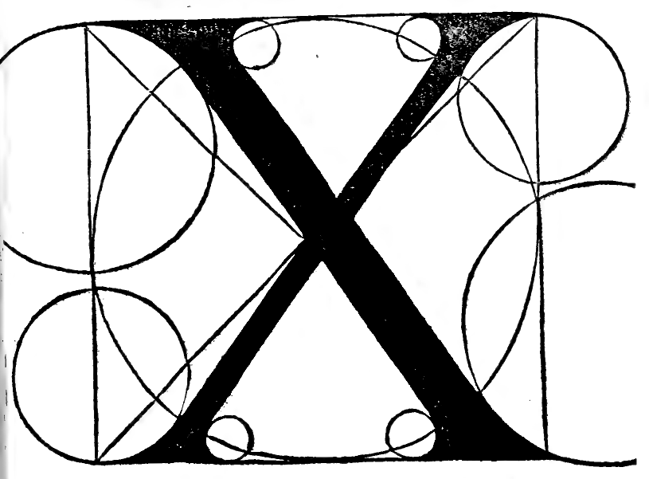

:layout: book
:canonical_id: Letter X
:folio: 0181

.. _plates-alphabet-x-it:

Lettera X (Folio 0181)
======================

.. rubric:: Proporzioni costruttive della lettera x

.. folio:: 0181

   Lettera X (Folio 0181)

Questa lettera X vol tutto el suo quadro incrociando sue gambe nella intersecatione de li diametri. E luna vol esser grossa la nona parte de laltezza. Laltra la mita prese diametraliter terminando sue gambe con debita gratia secondo la forza de li tondi piccoli.
