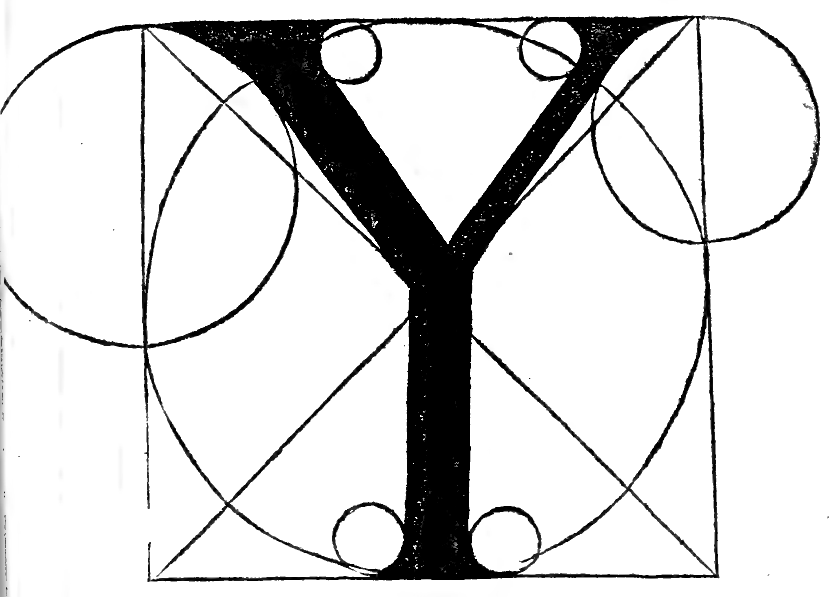

:layout: book
:canonical_id: Letter Y
:folio: 0183

.. _plates-alphabet-y-de:

Buchstabe Y (Folio 0183)
========================

.. rubric:: Konstruktive Proportionen des Buchstabens Y

.. folio:: 0183

   Lettera Y (Folio 0183)

Dieser Buchstabe Y erfordert das ganze Quadrat. Das rechte und linke Bein müssen so dick sein wie das Verhältniss derer des V aufweist, abgesehen dass sie genau im Durchschnitt der Durchmesser endigen. Und von da nach unten zieht man von ihrer Verbindung bis zur Basis eine ein Neuntel der Quadratseite dicke Linie. Die Spitzen oben endigen auf ihren Kreisen, wie du siehst.
