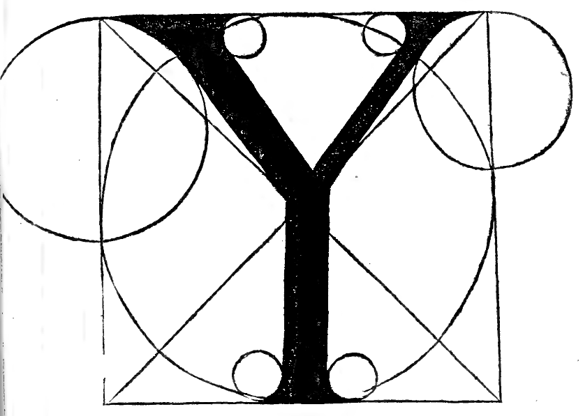

:layout: book
:canonical_id: Letter Y
:folio: 0183

.. _plates-alphabet-y:
.. _plates-alphabet-y-en:

Letter Y (Folio 0183)
=====================

.. rubric:: Constructive Proportions of Capital Letter Y

.. folio:: 0183

   Lettera Y (Folio 0183)

This letter Y requires the entire square; the right and left upper branches have the same thickness and proportion as those of the V, except that they meet at the central intersection of the diameters, and from there downward their junction is drawn vertically to the base of the square with a thickness of one-ninth of the square; the upper heads terminate on their small circles, as you see.
