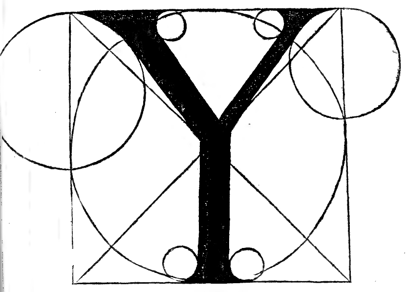

:layout: book
:canonical_id: Letter Y
:folio: 0183

.. _plates-alphabet-y-it:

Lettera Y (Folio 0183)
======================

.. rubric:: Proporzioni costruttive della lettera y

.. folio:: 0183

   Lettera Y (Folio 0183)

Questa lettera Y vol tutto el quadro; le gambe dextra e senistra vogliano esser grosse comme la proportione de quelle del V, salvo che le terminano a poncto in su la intersecatione de li diametri, e da inde in giù si tira lor conjunctione ala basa del quadrato grossa el nono del quadrato; le teste de sopra finescano su li soi tondi comme vedi.
