:layout: book
:canonical_id: Appendix I
:folio: 0139–0183

.. _plates-alphabet-en:

Appendix I: The Roman Geometric Alphabet
========================================

.. rubric:: Constructive Proportions of the Twenty-Three Classical Capitals from the Circle and Square

Lettera A (Folio 0139)
----------------------

.. folio:: 0139

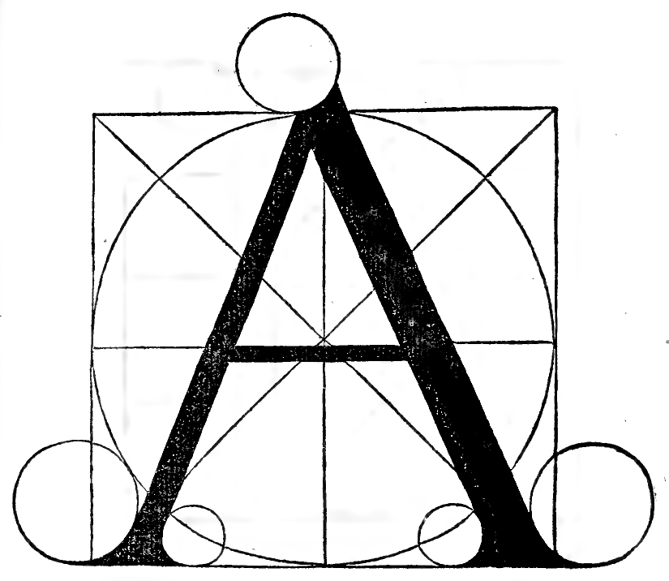

   Lettera A (Folio 0139)

This letter A is drawn from the circle and its square: the right leg must be one-ninth of the height in thickness. The left leg must be half the thickness of the thick leg. The middle crossbar must be one-third the thickness of the thick leg. The width of the said letter is determined by each leg passing through the intersection of the diagonals, the middle crossbar lying slightly lower, as you see here by the marked diameters.

Lettera B (Folio 0141)
----------------------

.. folio:: 0141

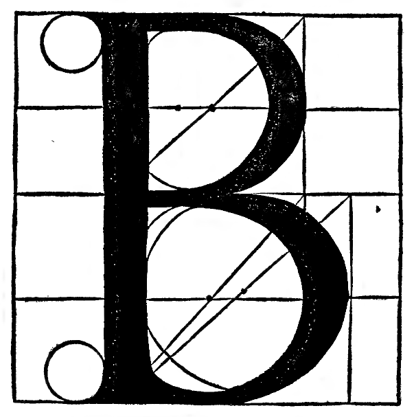

   Lettera B (Folio 0141)

This letter B is composed of two circles, of which the lower is the larger by one-ninth—that is, its diameter must be five-ninths of the total height, and the upper circle four-ninths in diameter, as is proportionally presented to your eyes above.

Lettera C (Folio 0143)
----------------------

.. folio:: 0143

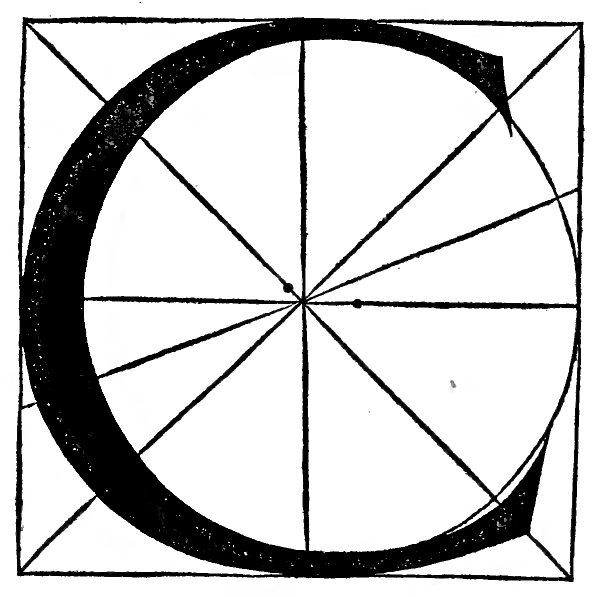

   Lettera C (Folio 0143)

This letter C is drawn from the circle and its square, thickening the curve by a quarter-part on the outside and inside. The upper head terminates above the intersection of the diagonal and circumference; the lower passes beyond the intersection by half a ninth toward the corner of the square, as appears in the figure, and is hollowed out like an O.

Lettera D (Folio 0145)
----------------------

.. folio:: 0145

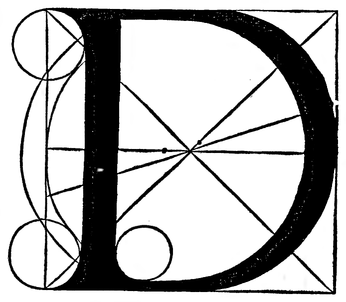

   Lettera D (Folio 0145)

This letter D is drawn from the circle and the square. The straight vertical leg lies between the diagonal intersections with a thickness of one-ninth; the curved body thickens like the other circular letters. The upper join is one-third the thickness of the thick leg, and the lower one-quarter or one-third.

Lettera E (Folio 0147)
----------------------

.. folio:: 0147

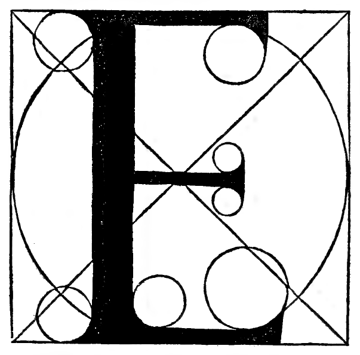

   Lettera E (Folio 0147)

This letter E is drawn from the circle and its square. The thick vertical stem is one-ninth of the height. The upper horizontal arm is half the thickness of the thick stem, and the lower arm likewise; the middle arm is one-third the thickness of the thick stem, like the crossbar of the A; and the said letter is half its square in width, and thus will be most perfect.

Lettera F (Folio 0149)
----------------------

.. folio:: 0149

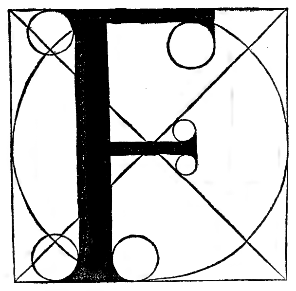

   Lettera F (Folio 0149)

This letter F is formed in the exact same manner as the letter E, neither more nor less, except that F lacks the third [lowest] arm, as you had at length in the place of the said E with all its proportions; wherefore let that suffice here.

Lettera G (Folio 0151)
----------------------

.. folio:: 0151

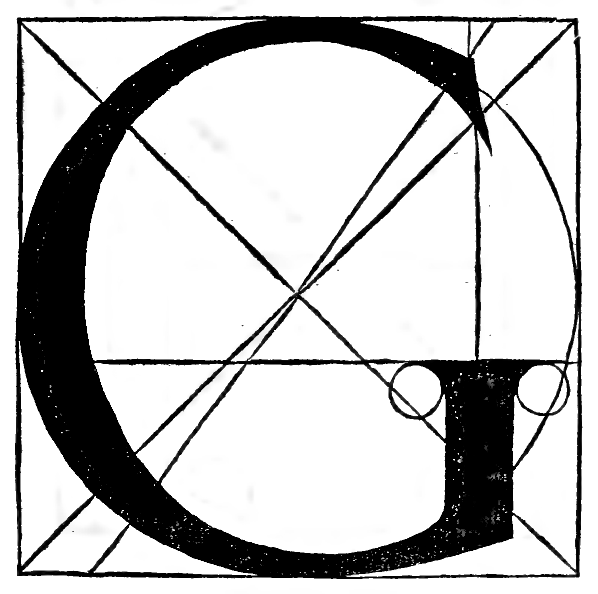

   Lettera G (Folio 0151)

This letter G is formed like the C from its circle and square. The upright lower stem is one-third of its square in height, and one-ninth of the height of its square in thickness.

Lettera H (Folio 0153)
----------------------

.. folio:: 0153

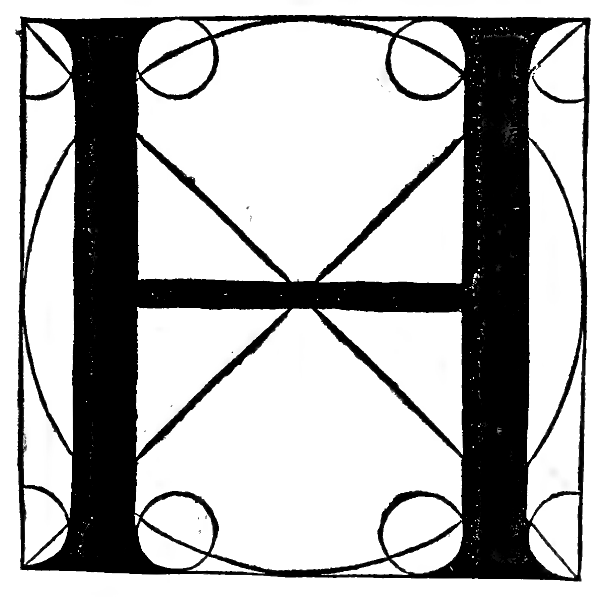

   Lettera H (Folio 0153)

This letter H is drawn from the circle and its square. Its two thick vertical stems are formed through the intersections where the circumference of the circle and the diagonals of the square cross. The thickness of the said stems is one-ninth of the height, and the crossbar is drawn along the horizontal diameter with a thickness equal to one-third of the thick stem, like the crossbar of the A.

.. note:: **Winterberg Critical Footnote (1889)**:

   **Winterberg Note (1889, p. 358)**: In the 1509 Italian text (*'doue se intersecano li diametri del tondo suo quadro'*), read more precisely: *where the circumference (periphery) of the circle and the diagonals of its square intersect*.

Lettera I / J (Folio 0155)
--------------------------

.. folio:: 0155

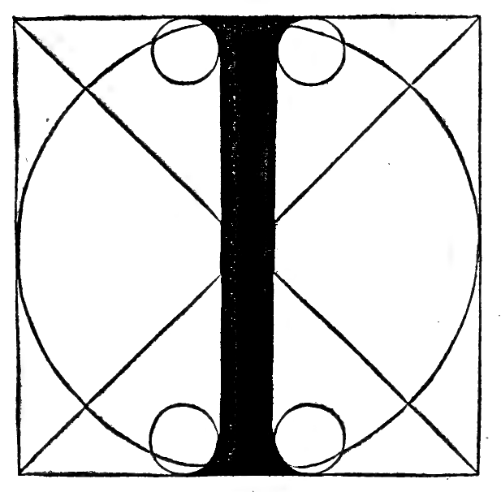

   Lettera I / J (Folio 0155)

This letter I is drawn from the circle and the square; its thickness is one-ninth of the height, so that its formation is the easiest among the others.

Lettera K (Folio 0157)
----------------------

.. folio:: 0157

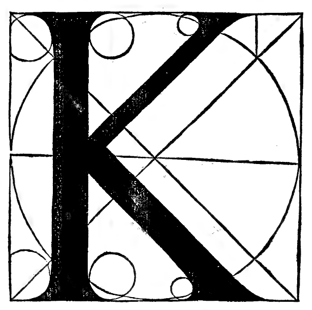

   Lettera K (Folio 0157)

This letter K is drawn from the circle and its square by drawing a diagonal of the square, upon which the two oblique branches meet and terminate at the middle of the thick stem. The lower branch is one-ninth in thickness like the other thick stems; the upper branch is half as thick, like the left leg of the A. The lower branch extends to or slightly beyond the diagonal intersection; the upper remains within the intersection.

Lettera L (Folio 0159)
----------------------

.. folio:: 0159

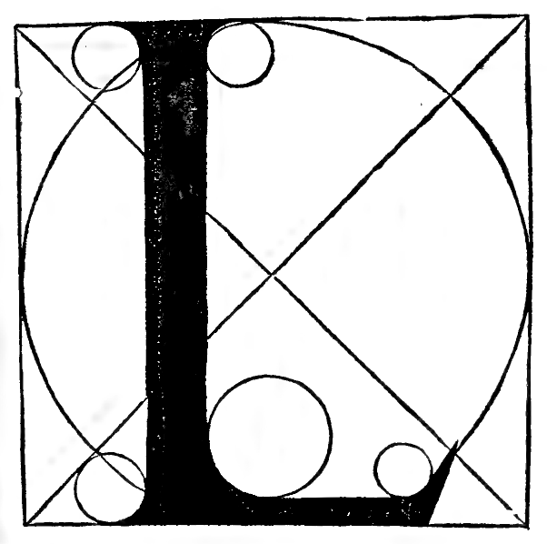

   Lettera L (Folio 0159)

This letter L is drawn from the circle and its square. Its vertical stem is one-ninth of the height in thickness, and its width is half the square with the small circles shown above. The thin lower arm is half the thickness of the vertical stem, like that of the E and the F.

Lettera M (Folio 0161)
----------------------

.. folio:: 0161

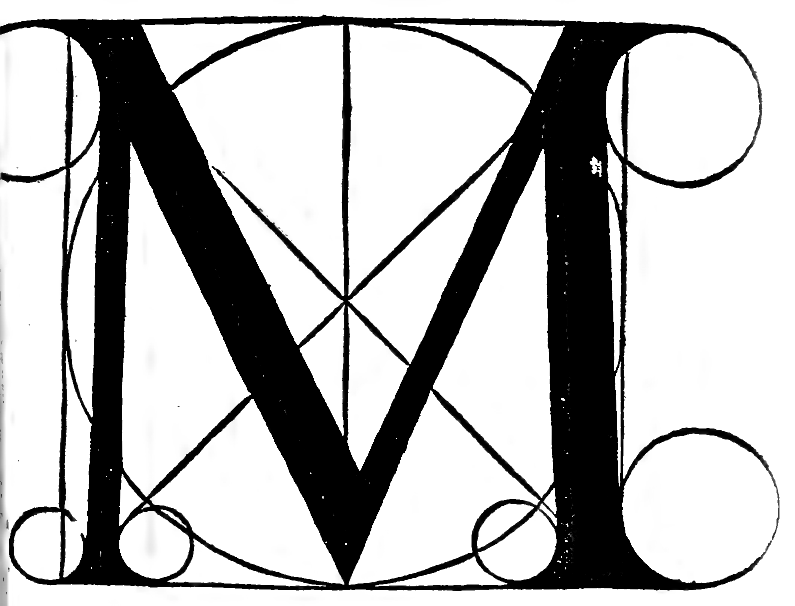

   Lettera M (Folio 0161)

This letter M is drawn from the circle and its square. The thin legs are half the thickness of the thick legs, like the left leg of the A. The outer legs stand slightly inside the square, and the middle strokes meet at the intersection of the diameters; their thick and thin strokes correspond to those of the A, as you may clearly understand from the figure above.

Lettera N (Folio 0163)
----------------------

.. folio:: 0163

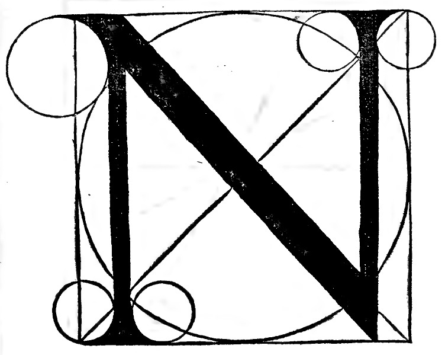

   Lettera N (Folio 0163)

This letter N is drawn from its circle and square. The first vertical leg stands outside the intersection of the diagonals; the middle diagonal stroke is one-ninth in thickness taken diametrically; the third leg stands outside the intersection. The first and last vertical legs are half the thickness of the thick diagonal stroke, namely half a head [one-eighteenth of the square].

.. note:: **Winterberg Critical Footnote (1889)**:

   **Winterberg Note (1889, p. 359)**: By *'la mita de la gamba grossa cioè duna testa'* ('half the thick leg, namely one head'), Pacioli means $\frac{1}{2} \times \frac{1}{9} = \frac{1}{18}$ of the side of the square.

Lettera O (primo modo perfectissimo) (Folio 0165)
-------------------------------------------------

.. folio:: 0165

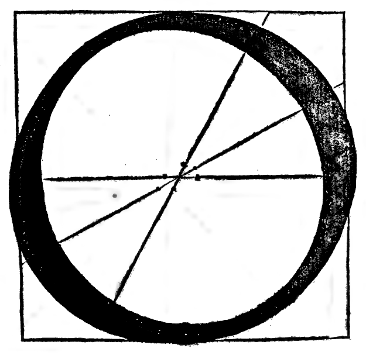

   Lettera O (primo modo perfectissimo) (Folio 0165)

This O is most perfect (*Questo O è perfectissimo*).

Lettera O (secondo modo) (Folio 0167)
-------------------------------------

.. folio:: 0167

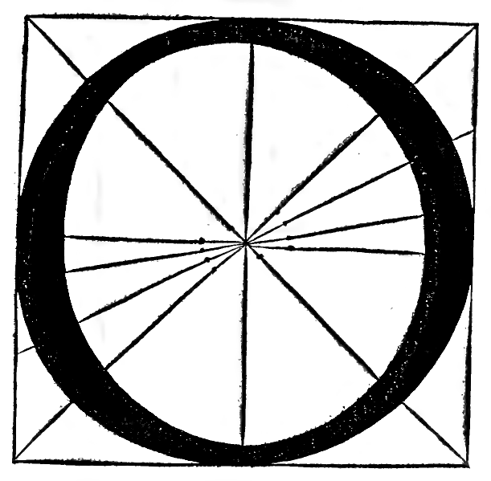

   Lettera O (secondo modo) (Folio 0167)

This letter O is drawn from the circle and its square, divided into four parts crosswise by the four central lines. Its body is one-ninth in thickness; its upper part is half the thickness of its thick belly. One of its bellies inclines upward and the other downward; the thin part of the body is one-third of its belly. And because there are two opinions concerning it, I have set another one before you that is most perfect according to my judgment; take whichever pleases you, and from them you will form the Q, as you will understand below in its place.

Lettera P (Folio 0169)
----------------------

.. folio:: 0169

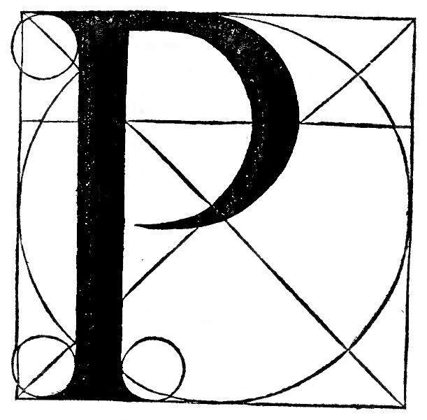

   Lettera P (Folio 0169)

This letter P is drawn from the circle and its square. Its thick stem is one-ninth in thickness. The form of the bowl is as large as the lower bowl of the B, and the thickness of its belly equals the thick stem; and the said letter begins at the intersections of the diagonals of the great circle, and thus will be most perfect.

Lettera Q (Folio 0171)
----------------------

.. folio:: 0171

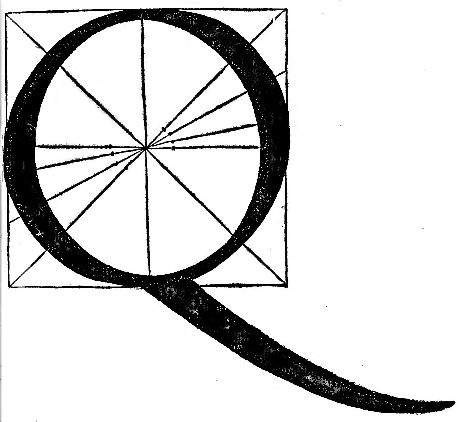

   Lettera Q (Folio 0171)

This letter Q, as I said above, is drawn from the O, terminating its tail three heads [three-ninths] of its height below the square, guiding the opposing thick bellies and thin strokes exactly as was told for the O. Its tail is nine heads long—that is, equal to the side of its right-angled square—and its tip rises one-ninth of the height at the end, following the curve of the pen with the tapering of its thickness.

Lettera R (Folio 0173)
----------------------

.. folio:: 0173

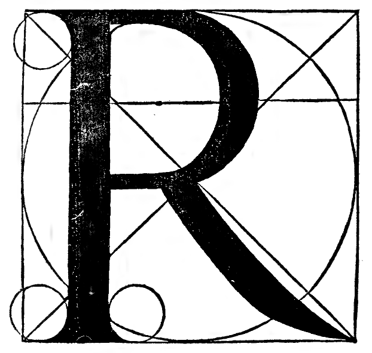

   Lettera R (Folio 0173)

This letter R is derived from the letter B; its upper bowl extends half a stem-width below the center. The whole letter remains within the diagonal intersections except for the curved tail, which extends beyond the intersections to the corner of the square, having a thickness of one-ninth and tapering to a fine point at the angle of the square in curved lines, as is manifest here in the example.

Lettera S (Folio 0175)
----------------------

.. folio:: 0175

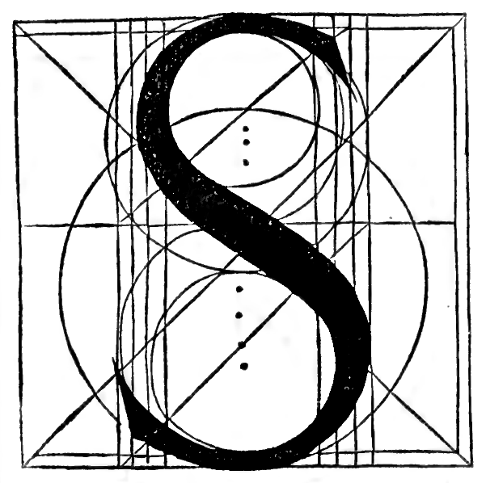

   Lettera S (Folio 0175)

This letter S is drawn from eight circles, and this is its law of construction as appears here in the example: finding their centers by means of their parallel lines, you will find the lower circles to be larger than the upper by one-third of a ninth [one twenty-seventh] of its square. The middle belly is exactly one-ninth of the height in thickness, and the thin curves one-third of that thickness, terminating the heads with due grace.

.. note:: **Winterberg Critical Footnote (1889)**:

   **Winterberg Note (1889, p. 360)**: Although the text states that the letter **S** is drawn from *eight* circles (*'se caua de octo tondi'*), in the 1509 woodcut figure (Folio 0175, ``0175.g1.png``) only *six* construction circles are actually drawn.

Lettera T (Folio 0177)
----------------------

.. folio:: 0177

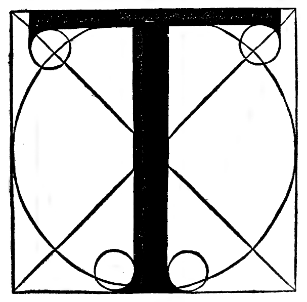

   Lettera T (Folio 0177)

This letter T is drawn from its square and circle. The thick vertical stem is formed exactly as was said for the I. The horizontal crossbar is half the thickness of the vertical stem, like the upper arms of E and F, and terminates half a head [one-eighteenth] inside each side of its square, making it most pleasing to the sight.

Lettera V (Folio 0179)
----------------------

.. folio:: 0179

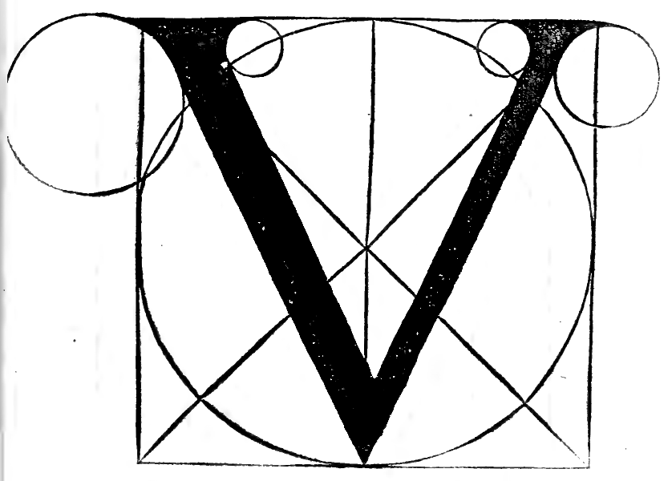

   Lettera V (Folio 0179)

This letter V requires its entire square. The left leg is one-ninth of its square in thickness taken diametrically, like the right leg of the A and the diagonal of the N. The right leg is half the thickness of the thick leg, likewise taken diametrically like the left leg of the A, and terminates in a point at the base of the square at the end of the vertical diameter of the circle.

Lettera X (Folio 0181)
----------------------

.. folio:: 0181

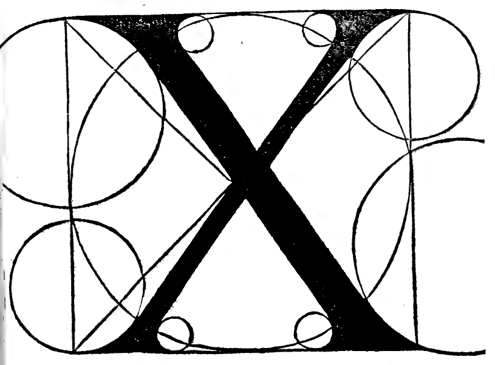

   Lettera X (Folio 0181)

This letter X requires its entire square, crossing its legs at the central intersection of the diagonals. One leg is one-ninth of the height in thickness, and the other half as thick, taken diametrically, terminating its legs with due grace according to the curvature of the small circles.

Lettera Y (Folio 0183)
----------------------

.. folio:: 0183

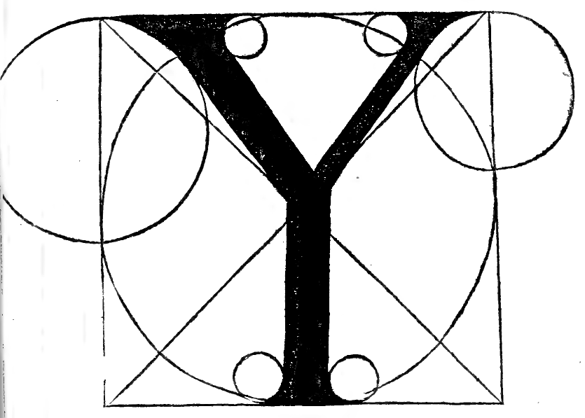

   Lettera Y (Folio 0183)

This letter Y requires the entire square; the right and left upper branches have the same thickness and proportion as those of the V, except that they meet at the central intersection of the diameters, and from there downward their junction is drawn vertically to the base of the square with a thickness of one-ninth of the square; the upper heads terminate on their small circles, as you see.
