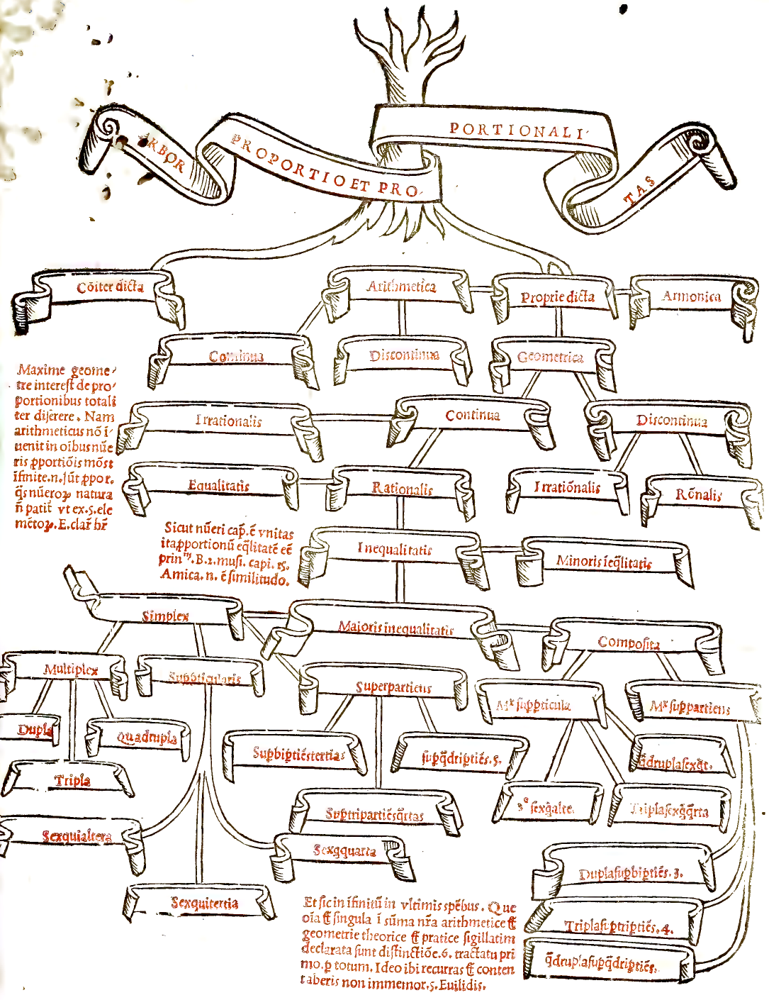

:layout: book
:canonical_id: Arch. Folio 0311
:folio: 0311

.. _plates-architectural-arbor_proportionis-de:

Folio 0311: Arbor Proportio et Proportionalitas (Baum der Proportionen)
=======================================================================

.. folio:: 0311

   :term:`Arbor Proportio et Proportionalitas <arbor-proportionis>`

STAMMBAUM DER PROPORTION UND PROPORTIONALITÄT (:term:`ARBOR PROPORTIO ET PROPORTIONALITAS <arbor-proportionis>`).

Vor allem dem Geometer kommt es zu, vollständig über die Proportionen zu handeln; denn der Arithmetiker findet nicht in allen Zahlen das Mass des Verhältnisses, da es unendlich viele Proportionen gibt, welche die Natur der Zahlen nicht zulässt, wie aus dem V. Buche der Elemente :person:`Euklids <euclid>` klar hervorgeht.

Wie die Einheit das Haupt der Zahl ist, so ist die Gleichheit der Ursprung der Proportionen (:person:`Boethius <boethius>`, De institutione musica II, c. 15).

Und so bis ins Unendliche in den letzten Arten; welches alles im Einzelnen in unserer :cite:`Summa de Arithmetica <pacioli:summa>` et :term:`Geometria <geometria>` (Distinctio VI, Tractatus I) erklärt ist.
