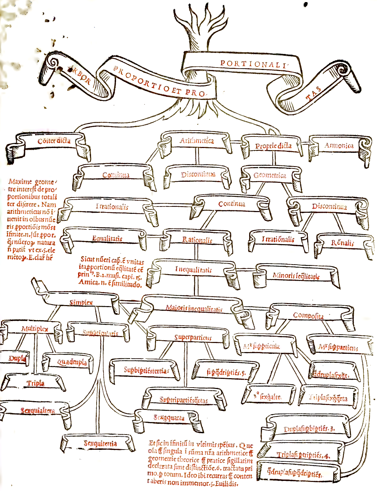

:layout: book
:canonical_id: Arch. Folio 0311
:folio: 0311

.. _plates-architectural-arbor_proportionis:
.. _plates-architectural-arbor_proportionis-en:

Folio 0311: Arbor Proportio et Proportionalitas
===============================================

.. folio:: 0311

   :term:`Arbor Proportio et Proportionalitas <arbor-proportionis>`

:term:`ARBOR PROPORTIO ET PROPORTIONALITAS <arbor-proportionis>` (Tree of Ratio and Proportionality): Above all it pertains to the geometer to treat completely of proportions; for the arithmetician does not find the measure of ratio in all numbers, since there are infinitely many ratios which the nature of numbers does not admit, as is clear from Book V of :person:`Euclid <euclid>`'s Elements. Just as unity is the head of number, so equality is the principle of proportions (:person:`Boethius <boethius>`, De institutione musica II, c. 15).
