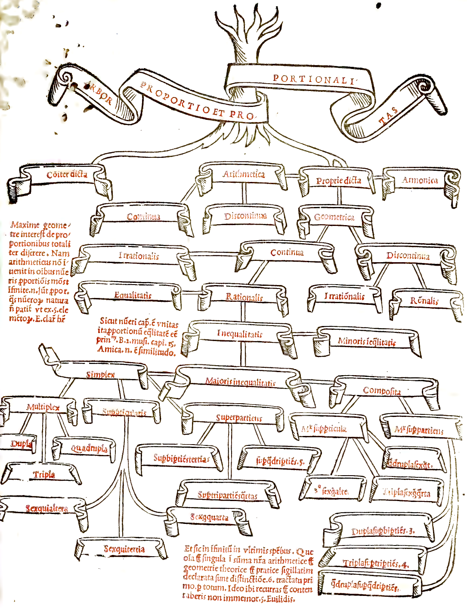

:layout: book
:canonical_id: Arch. Folio 0311
:folio: 0311

.. _plates-architectural-arbor_proportionis-it:

Folio 0311: Arbor Proportio et Proportionalitas
===============================================

.. folio:: 0311

   :term:`Arbor Proportio et Proportionalitas <arbor-proportionis>`

:term:`ARBOR PROPORTIO ET PROPORTIONALITAS <arbor-proportionis>`.

Maxime geometre interest de proportionibus totaliter disserere. Nam arithmeticus non invenit in omnibus numeris proportionis modum: infinite. n. sunt proportiones quas numerorum natura non patitur ut ex 5. elementorum E. clare habetur.

Sicut numeri caput est unitas, ita proportionum aequalitatem esse principium. B. 2. musi. capi. 15. Amica. n. est similitudo.

Et sic in infinitum in ultimis speciebus. Quae omnia et singula in Summa nostra arithmetice et geometrie theorice et pratice sigillatim declarata sunt distinctione 6. tractatu primo per totum. Ideo ibi recurras et contentaberis non immemor 5. Euclidis.
