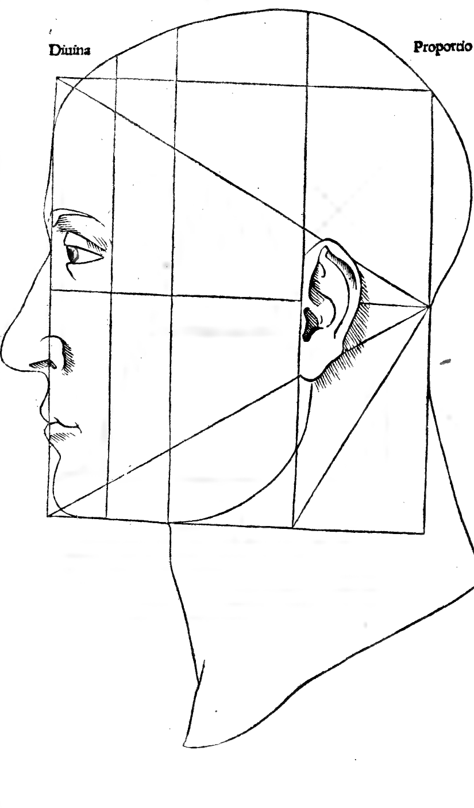

:layout: book
:canonical_id: Arch. Folio 0137
:folio: 0137

.. _plates-architectural-caput_humanum-de:

Folio 0137: Divina Proportio — Caput Humanum (Proportionalprofil des menschlichen Kopfes)
=========================================================================================

.. folio:: 0137

   Divina Proportio — Caput Humanum (Proportional Profile of the Human Head)

Divina Proportio. Proportionale Construction des menschlichen Kopfes im Dreieck- und Quadratnetz (Tractat über die Architektur, Cap. I–II).
