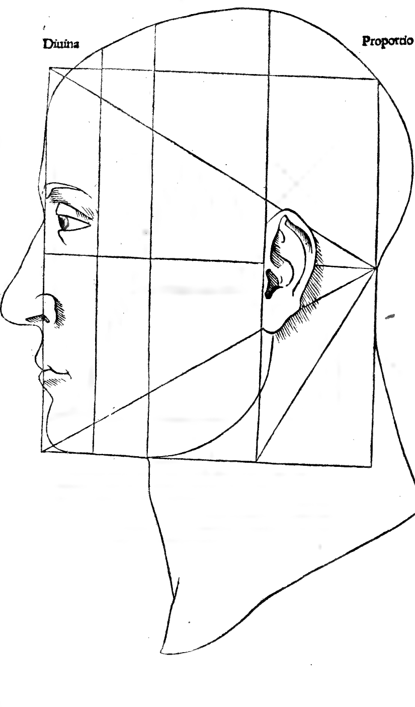

:layout: book
:canonical_id: Arch. Folio 0137
:folio: 0137

.. _plates-architectural-caput_humanum:
.. _plates-architectural-caput_humanum-en:

Folio 0137: Divina Proportio — Caput Humanum (Proportional Profile of the Human Head)
=====================================================================================

.. folio:: 0137

   Divina Proportio — Caput Humanum (Proportional Profile of the Human Head)

Divina Proportio: Proportional profile of the human head inscribed in the equilateral triangle and square grid (:cite:`Tractato de l'Architectura <pacioli:architectura>`, Cap. I–II).
