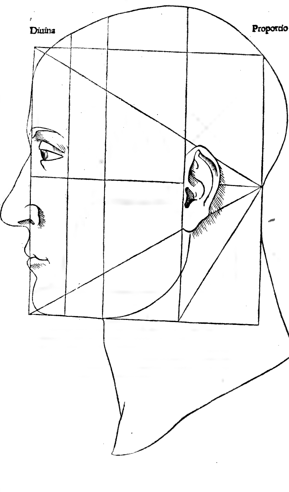

:layout: book
:canonical_id: Arch. Folio 0137
:folio: 0137

.. _plates-architectural-caput_humanum-it:

Folio 0137: Divina Proportio — Caput Humanum
============================================

.. folio:: 0137

   Divina Proportio — Caput Humanum (Proportional Profile of the Human Head)

Divina Proportio. Figura del capo humano proportionato secondo il triangolo :term:`equilatero <equilatero>` e il quadrato (:cite:`Tractato de l'Architectura <pacioli:architectura>`, Cap. I–II).
