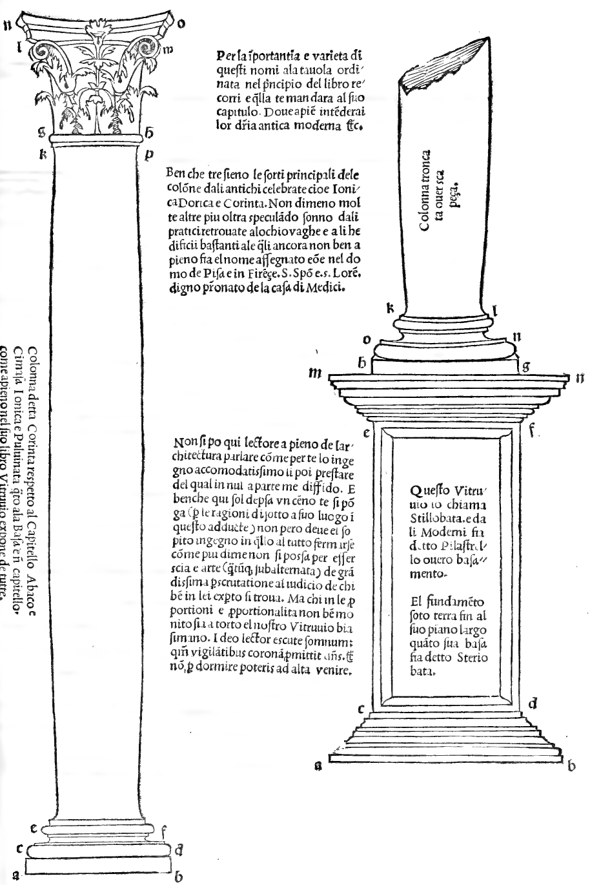

:layout: book
:canonical_id: Arch. Folio 0213
:folio: 0213

.. _plates-architectural-colonna_corinta-de:

Folio 0213: Korinthische, ionische und pulvinierte Säule mit Stylobat und Stereobat
===================================================================================

.. folio:: 0213

   Colonna Corinta, Jonica e :term:`Pulvinata <pulvinata>` con :term:`Stilobata <stilobata>` e :term:`Steriobata <steriobata>`

Säule, korinthisch genannt, bezüglich des Capitäls, Abacus und Gesims; jonische und Polstersäule bezüglich der Basis und am Capitäl, wie :person:`Vitruv <vitruvius>` in seinem Buche vor Allem deutlich darlegt.

Wegen der Wichtigkeit und Verschiedenheit dieser Namen geh' auf die am Anfange des Buches angeordnete Tafel zurück und diese wird dich auf das betreffende Capitel hinweisen, woraus du vollkommen ihre Unterschiede im Alterthum und jetzt verstehen wirst.

Obwohl der Hauptsäulengattungen drei sind, welche von den Alten gepriesen, nämlich die dorische, jonische und korinthische, so sind nichtsdestoweniger viele andere darüber hinausspekulirend von den Praktikern aufgefunden, die für das Auge schön und für die Bauten genügend sind, nämlich im Dom zu Pisa und Florenz, S. Spirito und S. Lorenzo, dem würdigen Patronat des Hauses Medici.

Dies nennt :person:`Vitruv <vitruvius>` Stilobat, und von den Modernen wird es Pilaster oder Basament genannt. Das Fundament unter der Erde bis zu seiner Grundebene, ebenso breit wie seine Basis, heisst Stereobat.
