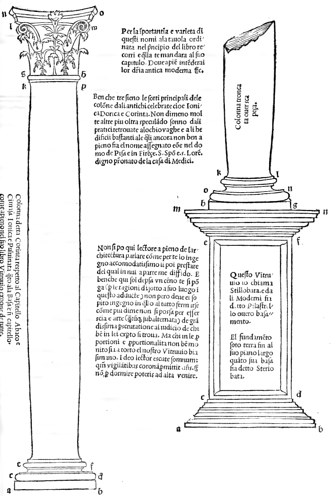

:layout: book
:canonical_id: Arch. Folio 0213
:folio: 0213

.. _plates-architectural-colonna_corinta:
.. _plates-architectural-colonna_corinta-en:

Folio 0213: Colonna Corinta, Jonica e Pulvinata con Stilobata e Steriobata
==========================================================================

.. folio:: 0213

   Colonna Corinta, Jonica e :term:`Pulvinata <pulvinata>` con :term:`Stilobata <stilobata>` e :term:`Steriobata <steriobata>`

Corinthian, Ionic, and Pulvinated Column with :term:`Stylobate <stilobata>` (Pedestal) and :term:`Stereobate <steriobata>`: Column called Corinthian with respect to its capital, abacus, and cymatium, and Ionic and pulvinated with respect to its base and capital, as :person:`Vitruvius <vitruvius>` explains in full, alongside modern columns in the Cathedral of Pisa and in Santo Spirito and San Lorenzo in Florence under the patronage of the House of Medici.
