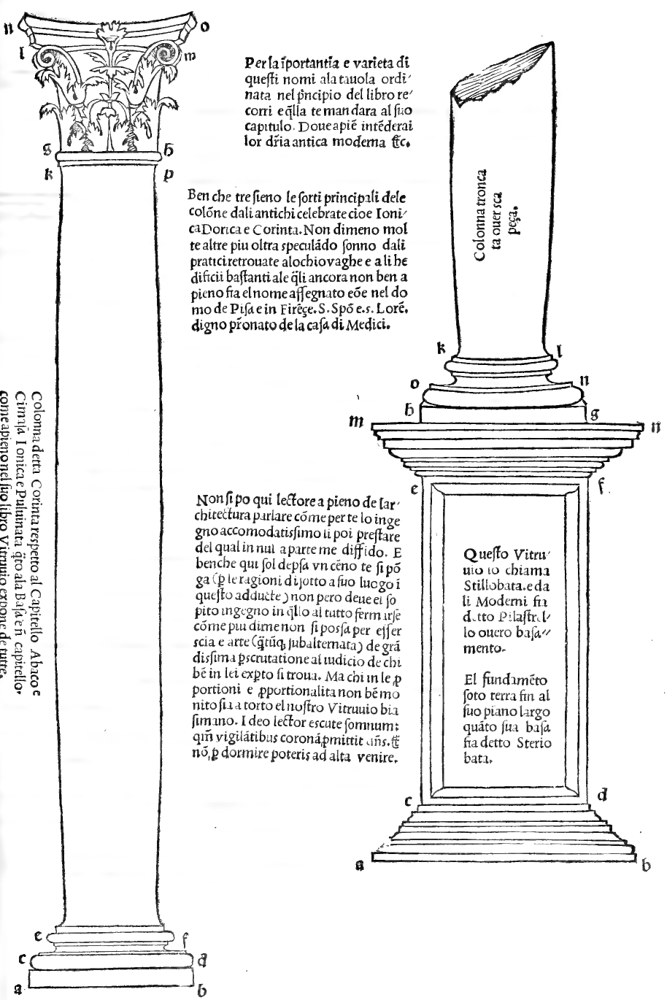

:layout: book
:canonical_id: Arch. Folio 0213
:folio: 0213

.. _plates-architectural-colonna_corinta-it:

Folio 0213: Colonna Corinta, Jonica e Pulvinata con Stilobata e Steriobata
==========================================================================

.. folio:: 0213

   Colonna Corinta, Jonica e :term:`Pulvinata <pulvinata>` con :term:`Stilobata <stilobata>` e :term:`Steriobata <steriobata>`

Colonna detta Corinta respecto al :term:`Capitello <capitello>`, :term:`Abaco <abaco>` e Cimasa; Jonica e :term:`Pulvinata <pulvinata>` quanto ala Basa e in :term:`capitello <capitello>` come apieno nel suo libro :person:`Vitruvio <vitruvius>` expone de tutte.

Per la importantia e varietà di questi nomi ala tavola ordinata nel principio del libro recorri e quella te mandara al suo capitulo. Dove apieno intenderai lor differentia antica e moderna etc.

Benche tre sieno le sorti principali de le colonne dali antichi celebrate cioè Jonica, Dorica e Corinta: Non di meno molte altre più oltra speculando sonno dali pratici retrovate alochio vaghe e a li hedificii bastanti ale quali ancora non ben a pieno fia el nome assegnato cioè nel domo de Pisa e in Firence San Spirito e San Lorenzo digno patronato de la casa di Medici.

Questo :person:`Vitruvio <vitruvius>` lo chiama Stillobata e da li Moderni fia detto :term:`Pilastrello <stilobata>` overo :term:`basamento <stilobata>`. El fundamento soto terra fin al suo piano largo quanto sua basa fia detto :term:`Steriobata <steriobata>`.
