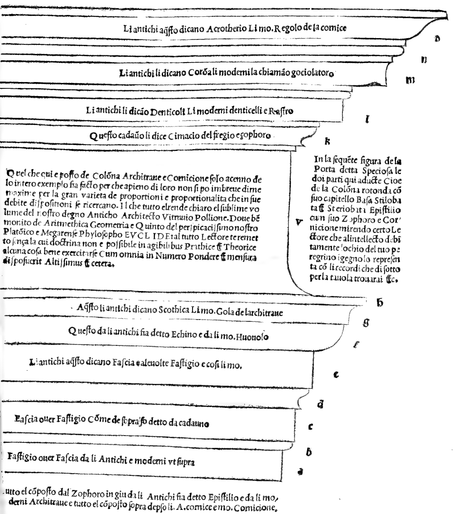

:layout: book
:canonical_id: Arch. Folio 0215
:folio: 0215

.. _plates-architectural-epistilio_cornice-de:

Folio 0215: Epistyl (Architrav), Zophoros (Fries) und Gesims (Cornicione)
=========================================================================

.. folio:: 0215

   :term:`Epistilio <epistilio>` (:term:`Architrave <epistilio>`), :term:`Zophoro <zophoro>` (:term:`Fregio <zophoro>`) e :term:`Cornicione <cornicione>`

Die ganze Zusammensetzung vom Zophoros abwärts wird von den Alten Epistyl und von den Modernen Architrav genannt, und die ganze Zusammensetzung oberhalb desselben von den Alten „Karnies“ und von den Modernen „:term:`Cornicione <cornicione>`“.

- a = Giebelabschluss oder Bündel von Alten und Modernen;
- c = Bündel oder Giebelabschluss wie oben gesagt;
- e = Die Alten sagen hiefür Bündel und zuweilen Giebelabschluss, und ebenso die Modernen;
- f = Dies wird von den Alten Echinus und von den Modernen Eierstab genannt;
- g = Hiefür sagen die Alten Scotia, die Modernen Kehle des Architravs;
- k = Dieses nennen beide Gesimse des Frieses und Zophoros;
- l = Die Alten sagen hier Zähne, die Modernen Zähnchen und „Rechen“;
- m = Die Alten sagen hier Krone, die Modernen Dachtraufe;
- o = Die Alten sagen dafür Akrotherion, die Modernen Stab des Karnieses.

Das was hier über Säule, Architrav und Karnies beigebracht, ist nur als Skizze des vollständigen Beispiels dargestellt, weil man vollständig darüber in kurzen Worten nicht reden kann wegen der grossen Verschiedenheit der Verhältnisse und Proportionen. Alles das macht der erhabene Band unseres würdigen alten Architekten :person:`Vitruvius <vitruvius>` Pollio klar, worin über Arithmetik, Geometrie und das Fünfte (Perspective) unseres scharfsinnigen Platonikers und megaräischen Philosophen :person:`Euklid <euclid>` gut gehandelt worden: weil Alles nach Zahl, Gewicht und Mass der Höchste angeordnet hat.
