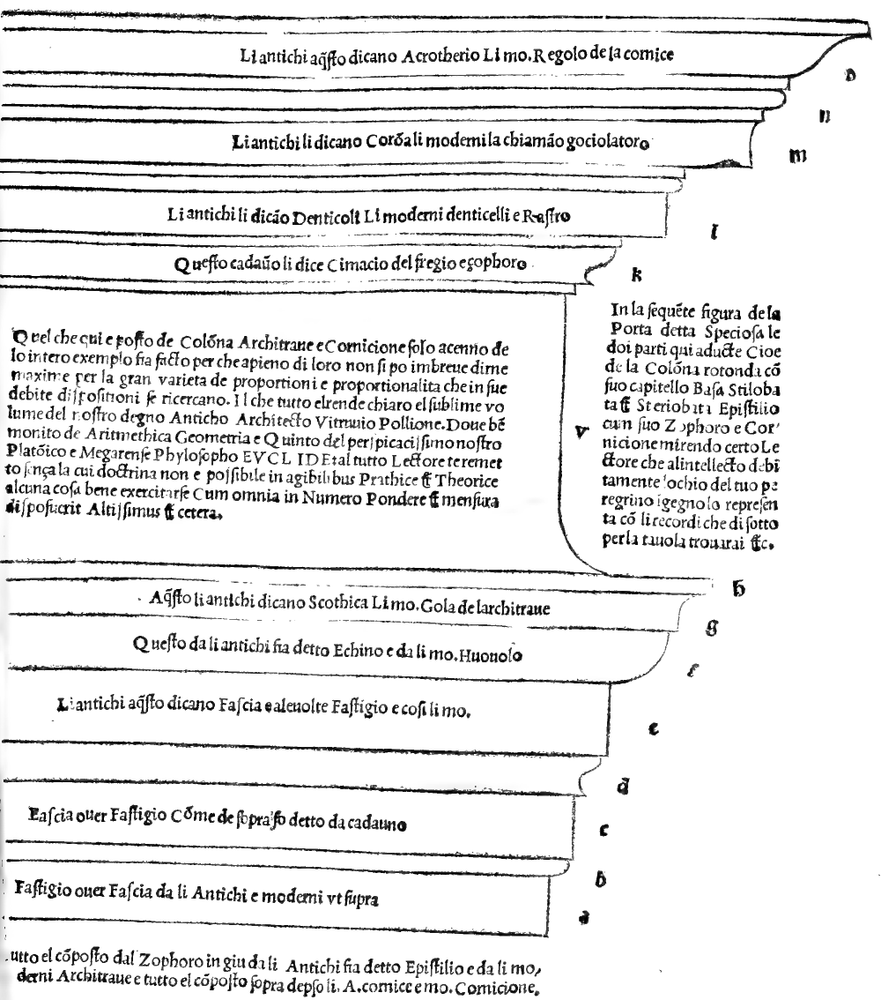

:layout: book
:canonical_id: Arch. Folio 0215
:folio: 0215

.. _plates-architectural-epistilio_cornice:
.. _plates-architectural-epistilio_cornice-en:

Folio 0215: Epistilio (Architrave), Zophoro (Fregio) e Cornicione
=================================================================

.. folio:: 0215

   :term:`Epistilio <epistilio>` (:term:`Architrave <epistilio>`), :term:`Zophoro <zophoro>` (:term:`Fregio <zophoro>`) e :term:`Cornicione <cornicione>`

Epistyle (:term:`Architrave <epistilio>`), Zophorus (Frieze), and Cornice: The entire assembly below the frieze is called Epistylium by the Ancients and :term:`Architrave <epistilio>` by the Moderns, and the assembly above it is called Cornice (with lettered mouldings a, c, e = Fascia; f = Echinus/Ovolo; g = Scotia/Gola; k = Cymatium; l = Dentils; m = Corona/Dripstone; o = Acroterium/Reglet).
