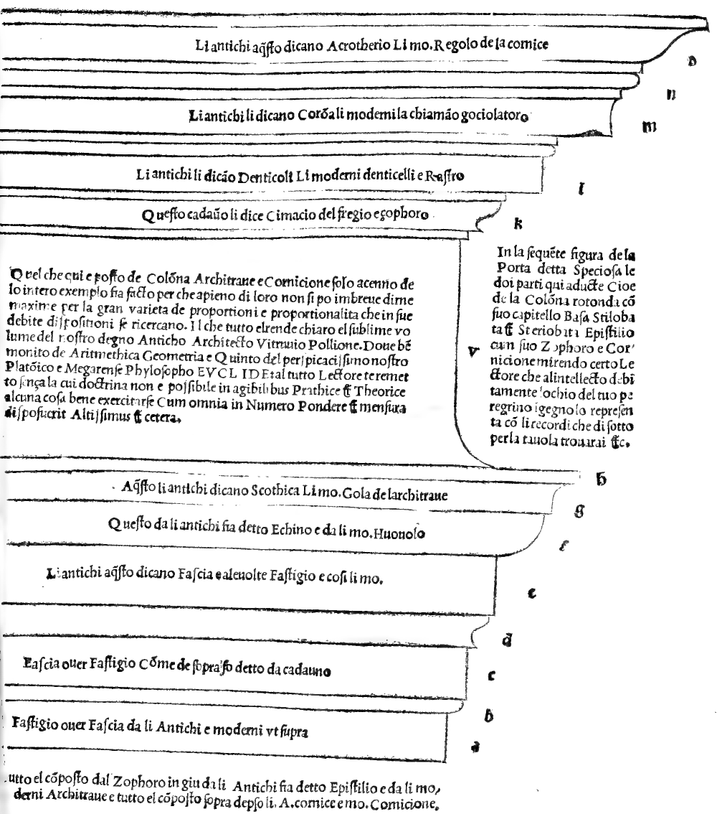

:layout: book
:canonical_id: Arch. Folio 0215
:folio: 0215

.. _plates-architectural-epistilio_cornice-it:

Folio 0215: Epistilio (Architrave), Zophoro (Fregio) e Cornicione
=================================================================

.. folio:: 0215

   :term:`Epistilio <epistilio>` (:term:`Architrave <epistilio>`), :term:`Zophoro <zophoro>` (:term:`Fregio <zophoro>`) e :term:`Cornicione <cornicione>`

Tutto el composto dal :term:`Zophoro <zophoro>` in giù da li Antichi fia detto :term:`Epistilio <epistilio>` e da li moderni :term:`Architrave <epistilio>`, e tutto el composto sopra depso li Antichi cornice e moderni :term:`cornicione <cornicione>`.

- a = :term:`Fastigio <fastigio>` over Fascia da li Antichi e moderni ut supra;
- c = Fascia over :term:`Fastigio <fastigio>` comme de sopra fo detto da cadauno;
- e = Li antichi a questo dicano Fascia e a le volte :term:`Fastigio <fastigio>` e cosi li moderni;
- f = Questo da li antichi fia detto :term:`Echino <echino>` e da li moderni :term:`Huovolo <echino>`;
- g = A questo li antichi dicano :term:`Scothia <scothia>`, li moderni gola de larchitrave;
- k = Questo cadauno lo dice Cimacio del :term:`Fregio <zophoro>` e :term:`Zophoro <zophoro>`;
- l = Li antichi li dicano :term:`Denticeli <denticeli>`, li moderni denticelli e Rastro;
- m = Li antichi li dicano Corona, li moderni la chiamano :term:`gociolatoro <corona>`;
- o = Li antichi a questo dicano Acrotherio, li moderni Regolo de la cornice.

Quel che qui e posto de Colonna, :term:`Architrave <epistilio>` e :term:`Cornicione <cornicione>` solo acenno de lo intero exemplo fia facto perche apieno di loro non si po in breve dirne maxime per la gran varietà de proportioni e proportionalita che in sue debite dispositioni se ricercano. Il che tutto el rende chiaro el sublime volume del nostro degno Anticho Architecto :person:`Vitruvio <vitruvius>` Pollione. Dove ben monito de :term:`Arithmetica <arithmetica>`, :term:`Geometria <geometria>` e Quinto del perspicacissimo nostro Platonico e Megarense Phylosopho :person:`Euclide <euclid>`. Tal tutto Lectore te remetto senza la cui doctrina non e possibile :term:`in agibilibus <in-agibilibus>` Prathice e Theorice alcuna cosa bene exercitarse: cum :cite:`omnia in numero, pondere et mensura <biblia:sapientia:11.21>` disposuerit Altissimus et cetera.
