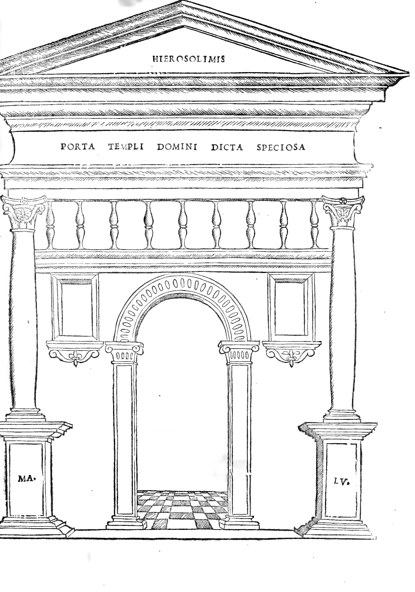

:layout: book
:canonical_id: Arch. Folio 0185
:folio: 0185

.. _plates-architectural-porta_speciosa-de:

Folio 0185: Porta Templi Domini Dicta Speciosa
==============================================

.. folio:: 0185

   :term:`Porta Templi Domini Dicta Speciosa <porta-speciosa>`

:term:`PORTA TEMPLI DOMINI DICTA SPECIOSA <porta-speciosa>`.

Hinsichtlich der Figur des „Speciosa“ genannten Thores des Tempels Salomonis und der hier vorgeführten beiden Theile: nämlich der runden Säule mit ihrem Capitäl, Basis, Stilobat und Stereobat, Epistil mit seinem Zophoros und Karnies, bin ich sicher, Leser, dass das Auge deines bewanderten Geistes es in richtiger Weise dem Verständniss vorführe.
