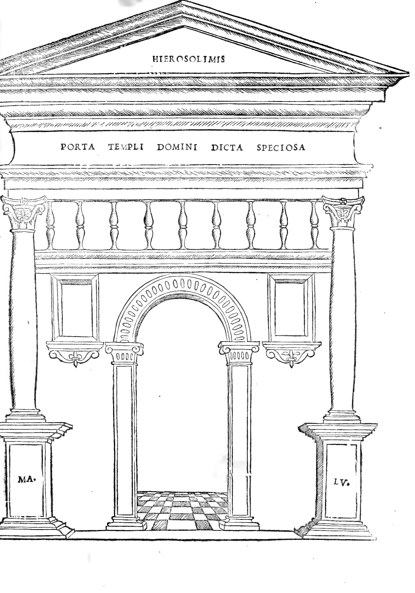

:layout: book
:canonical_id: Arch. Folio 0185
:folio: 0185

.. _plates-architectural-porta_speciosa:
.. _plates-architectural-porta_speciosa-en:

Folio 0185: Porta Templi Domini Dicta Speciosa
==============================================

.. folio:: 0185

   :term:`Porta Templi Domini Dicta Speciosa <porta-speciosa>`

:term:`PORTA TEMPLI DOMINI DICTA SPECIOSA <porta-speciosa>` (The Gate of the Lord's Temple Called Beautiful): In the present figure of the gate called Speciosa, the two parts adduced here—namely the round column with its capital, base, :term:`stylobate <stilobata>`, and :term:`stereobate <steriobata>`, and the epistyle with its frieze (zophorus) and cornice—are duly presented to your discerning eye.
