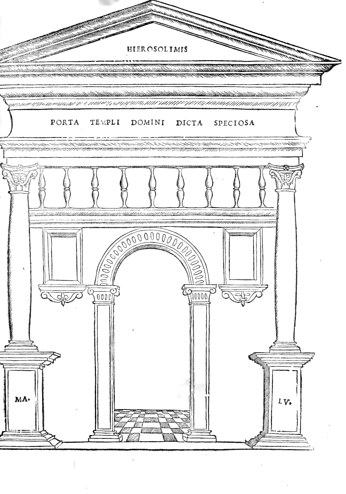

:layout: book
:canonical_id: Arch. Folio 0185
:folio: 0185

.. _plates-architectural-porta_speciosa-it:

Folio 0185: Porta Templi Domini Dicta Speciosa
==============================================

.. folio:: 0185

   :term:`Porta Templi Domini Dicta Speciosa <porta-speciosa>`

:term:`PORTA TEMPLI DOMINI DICTA SPECIOSA <porta-speciosa>`.

In la presente figura de la porta detta Speciosa le doi parti qui aducte cioè de la colonna rotonda con suo :term:`capitello <capitello>`, Basa, :term:`Stilobata <stilobata>` et :term:`Steriobata <steriobata>`, :term:`Epistilio <epistilio>` cum suo :term:`Zophoro <zophoro>` e :term:`Cornicione <cornicione>` mi rendo certo Lectore che al intellecto debitamente lochio del tuo peregrino ingegno lo representa.
