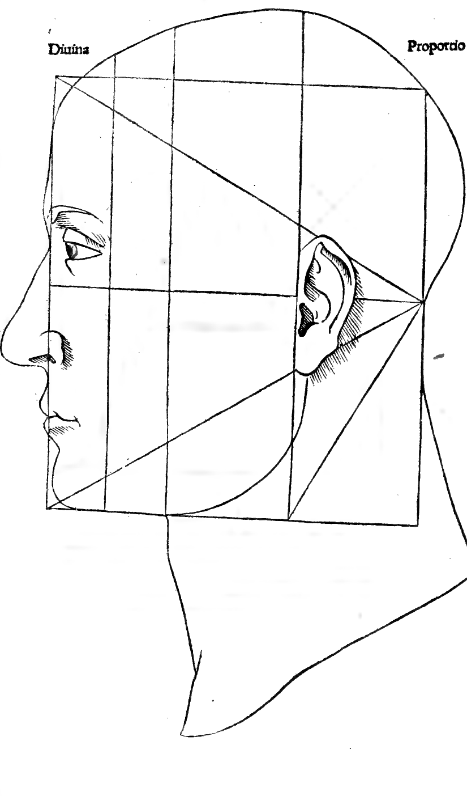
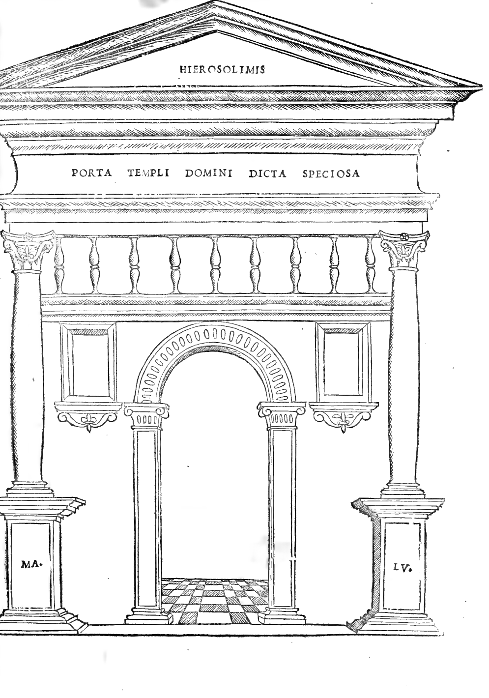
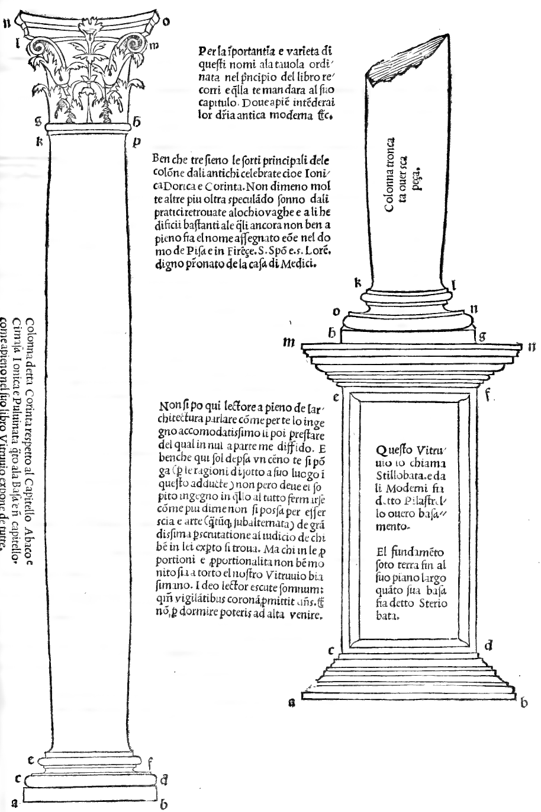
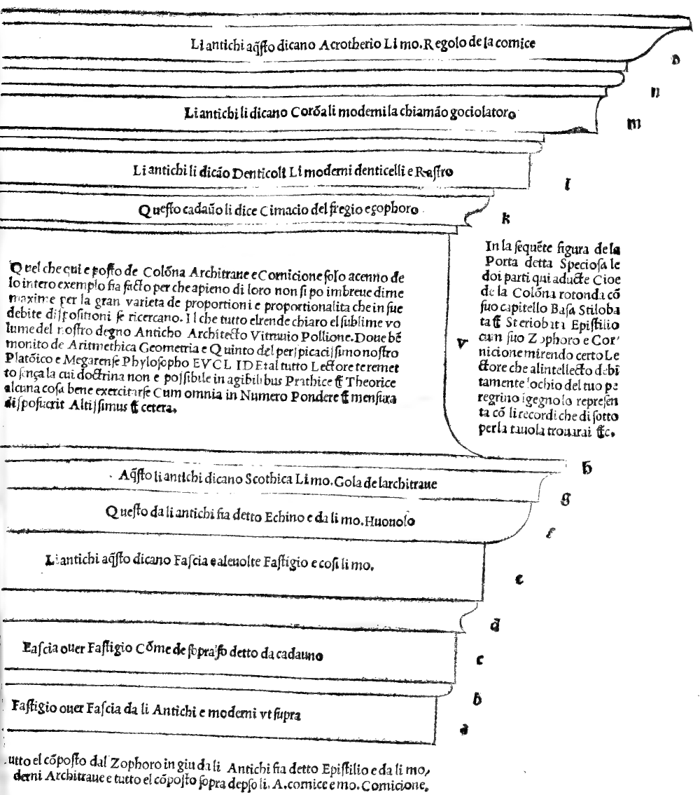
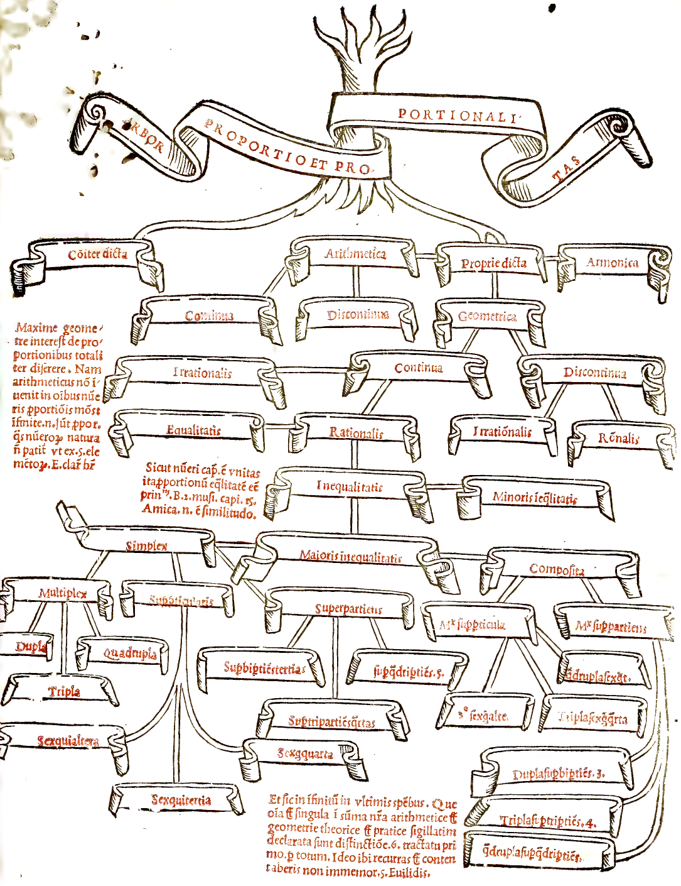

:layout: book
:canonical_id: Appendix II
:folio: 0137, 0185, 0213, 0215, 0311

.. _plates-architectural-it:

Appendice II: Tavole d'Architettura e Arbor Proportionis
========================================================

.. rubric:: Profilo umano, Porta Speciosa, Colonna Corinzia/Ionica, Trabeazione e Albero delle Proporzioni (1509)

Folio 0137: Divina Proportio — Caput Humanum (Proportional Profile of the Human Head)
-------------------------------------------------------------------------------------

.. folio:: 0137

   Divina Proportio — Caput Humanum (Proportional Profile of the Human Head)

Divina Proportio. Figura del capo humano proportionato secondo il triangolo :term:`equilatero <equilatero>` e il quadrato (Tractato de l'Architectura, Cap. I–II).

Folio 0185: Porta Templi Domini Dicta Speciosa
----------------------------------------------

.. folio:: 0185

   :term:`Porta Templi Domini Dicta Speciosa <porta-speciosa>`

:term:`PORTA TEMPLI DOMINI DICTA SPECIOSA <porta-speciosa>`.

In la presente figura de la porta detta Speciosa le doi parti qui aducte cioè de la colonna rotonda con suo :term:`capitello <capitello>`, Basa, :term:`Stilobata <stilobata>` et :term:`Steriobata <steriobata>`, :term:`Epistilio <epistilio>` cum suo :term:`Zophoro <zophoro>` e :term:`Cornicione <cornicione>` mi rendo certo Lectore che al intellecto debitamente lochio del tuo peregrino ingegno lo representa.

Folio 0213: Colonna Corinta, Jonica e Pulvinata con Stilobata e Steriobata
--------------------------------------------------------------------------

.. folio:: 0213

   Colonna Corinta, Jonica e :term:`Pulvinata <pulvinata>` con :term:`Stilobata <stilobata>` e :term:`Steriobata <steriobata>`

Colonna detta Corinta respecto al :term:`Capitello <capitello>`, :term:`Abaco <abaco>` e Cimasa; Jonica e :term:`Pulvinata <pulvinata>` quanto ala Basa e in :term:`capitello <capitello>` come apieno nel suo libro :person:`Vitruvio <vitruvius>` expone de tutte.

Per la importantia e varietà di questi nomi ala tavola ordinata nel principio del libro recorri e quella te mandara al suo capitulo. Dove apieno intenderai lor differentia antica e moderna etc.

Benche tre sieno le sorti principali de le colonne dali antichi celebrate cioè Jonica, Dorica e Corinta: Non di meno molte altre più oltra speculando sonno dali pratici retrovate alochio vaghe e a li hedificii bastanti ale quali ancora non ben a pieno fia el nome assegnato cioè nel domo de Pisa e in Firence San Spirito e San Lorenzo digno patronato de la casa di Medici.

Questo :person:`Vitruvio <vitruvius>` lo chiama Stillobata e da li Moderni fia detto :term:`Pilastrello <stilobata>` overo :term:`basamento <stilobata>`. El fundamento soto terra fin al suo piano largo quanto sua basa fia detto :term:`Steriobata <steriobata>`.

Folio 0215: Epistilio (Architrave), Zophoro (Fregio) e Cornicione
-----------------------------------------------------------------

.. folio:: 0215

   :term:`Epistilio <epistilio>` (:term:`Architrave <epistilio>`), :term:`Zophoro <zophoro>` (:term:`Fregio <zophoro>`) e :term:`Cornicione <cornicione>`

Tutto el composto dal :term:`Zophoro <zophoro>` in giù da li Antichi fia detto :term:`Epistilio <epistilio>` e da li moderni :term:`Architrave <epistilio>`, e tutto el composto sopra depso li Antichi cornice e moderni :term:`cornicione <cornicione>`.

- a = :term:`Fastigio <fastigio>` over Fascia da li Antichi e moderni ut supra;
- c = Fascia over :term:`Fastigio <fastigio>` comme de sopra fo detto da cadauno;
- e = Li antichi a questo dicano Fascia e a le volte :term:`Fastigio <fastigio>` e cosi li moderni;
- f = Questo da li antichi fia detto :term:`Echino <echino>` e da li moderni :term:`Huovolo <echino>`;
- g = A questo li antichi dicano :term:`Scothia <scothia>`, li moderni gola de larchitrave;
- k = Questo cadauno lo dice Cimacio del :term:`Fregio <zophoro>` e :term:`Zophoro <zophoro>`;
- l = Li antichi li dicano :term:`Denticeli <denticeli>`, li moderni denticelli e Rastro;
- m = Li antichi li dicano Corona, li moderni la chiamano :term:`gociolatoro <corona>`;
- o = Li antichi a questo dicano Acrotherio, li moderni Regolo de la cornice.

Quel che qui e posto de Colonna, :term:`Architrave <epistilio>` e :term:`Cornicione <cornicione>` solo acenno de lo intero exemplo fia facto perche apieno di loro non si po in breve dirne maxime per la gran varietà de proportioni e proportionalita che in sue debite dispositioni se ricercano. Il che tutto el rende chiaro el sublime volume del nostro degno Anticho Architecto :person:`Vitruvio <vitruvius>` Pollione. Dove ben monito de :term:`Arithmetica <arithmetica>`, :term:`Geometria <geometria>` e Quinto del perspicacissimo nostro Platonico e Megarense Phylosopho :person:`Euclide <euclid>`. Tal tutto Lectore te remetto senza la cui doctrina non e possibile in agibilibus Prathice e Theorice alcuna cosa bene exercitarse: cum :cite:`omnia in numero, pondere et mensura <biblia:sapientia:11.21>` disposuerit Altissimus et cetera.

Folio 0311: Arbor Proportio et Proportionalitas
-----------------------------------------------

.. folio:: 0311

   :term:`Arbor Proportio et Proportionalitas <arbor-proportionis>`

:term:`ARBOR PROPORTIO ET PROPORTIONALITAS <arbor-proportionis>`.

Maxime geometre interest de proportionibus totaliter disserere. Nam arithmeticus non invenit in omnibus numeris proportionis modum: infinite. n. sunt proportiones quas numerorum natura non patitur ut ex 5. elementorum E. clare habetur.

Sicut numeri caput est unitas, ita proportionum aequalitatem esse principium. B. 2. musi. capi. 15. Amica. n. est similitudo.

Et sic in infinitum in ultimis speciebus. Quae omnia et singula in Summa nostra arithmetice et geometrie theorice et pratice sigillatim declarata sunt distinctione 6. tractatu primo per totum. Ideo ibi recurras et contentaberis non immemor 5. Euclidis.
