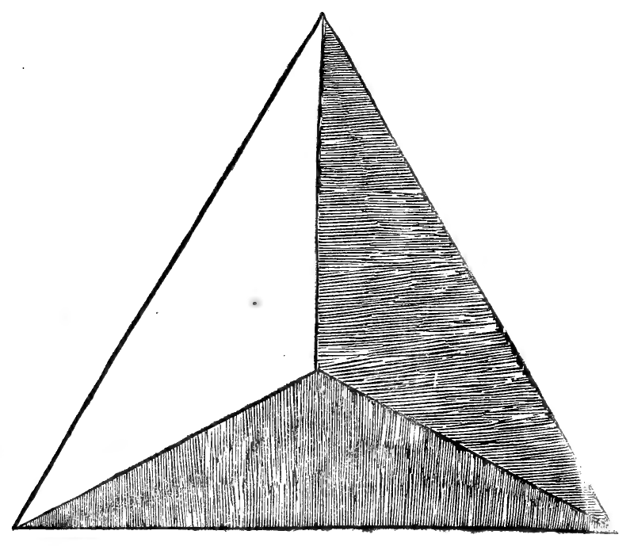

:layout: book
:canonical_id: Plate I
:folio: 0187

.. _plates-polyhedra-plate_01:
.. _plates-polyhedra-plate_01-en:

Plate I (Folio 0187) — Solid Regular Tetrahedron
================================================

.. rubric:: Perspective Woodcut by Leonardo da Vinci (1509)

.. folio:: 0187

   **Solid Regular Tetrahedron** — :term:`*Tetrahedron Planum Solidum* <tetrahedron>` (:term:`Τετράεδρον <tetrahedron>` :term:`ἐπίπεδον <planum>` :term:`στερεόν <solidum>`)
