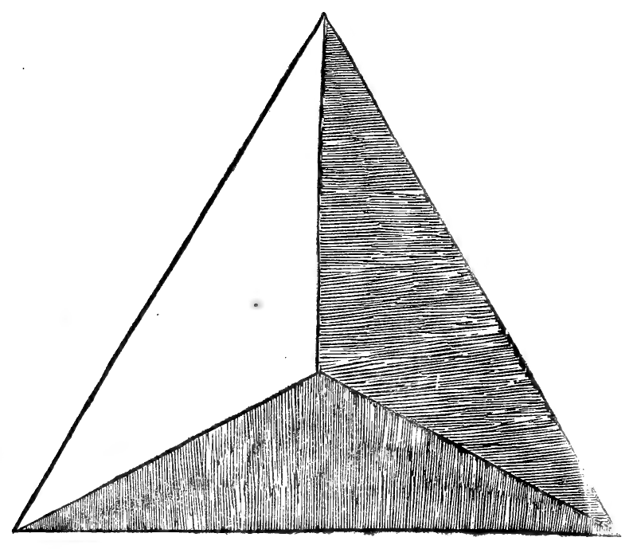

:layout: book
:canonical_id: Tabula I
:folio: 0187

.. _plates-polyhedra-plate_01-la:

Tabula I (Folio 0187) — Tetrahedron Planum Solidum
==================================================

.. rubric:: Figura Geometrica per Manum Leonardi Vincii (1509)

.. folio:: 0187

   :term:`*Tetrahedron Planum Solidum* <tetrahedron>` (:term:`Τετράεδρον <tetrahedron>` :term:`ἐπίπεδον <planum>` :term:`στερεόν <solidum>`)
