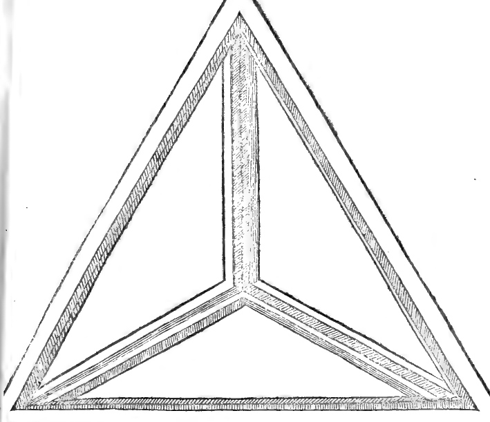

:layout: book
:canonical_id: Plate II
:folio: 0189

.. _plates-polyhedra-plate_02:
.. _plates-polyhedra-plate_02-en:

Plate II (Folio 0189) — Hollow Regular Tetrahedron
==================================================

.. rubric:: Perspective Woodcut by Leonardo da Vinci (1509)

.. folio:: 0189

   **Hollow Regular Tetrahedron** — :term:`*Tetrahedron Planum Vacuum* <tetrahedron>` (:term:`Τετράεδρον <tetrahedron>` :term:`ἐπίπεδον <planum>` :term:`κενόν <vacuum>`)
