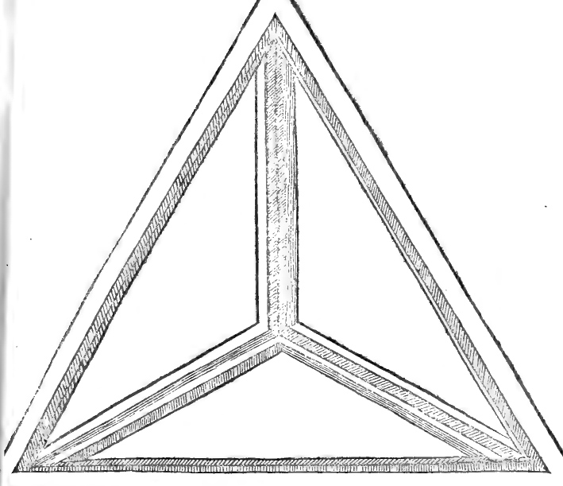

:layout: book
:canonical_id: Tabula II
:folio: 0189

.. _plates-polyhedra-plate_02-la:

Tabula II (Folio 0189) — Tetrahedron Planum Vacuum
==================================================

.. rubric:: Figura Geometrica per Manum Leonardi Vincii (1509)

.. folio:: 0189

   :term:`*Tetrahedron Planum Vacuum* <tetrahedron>` (:term:`Τετράεδρον <tetrahedron>` :term:`ἐπίπεδον <planum>` :term:`κενόν <vacuum>`)
