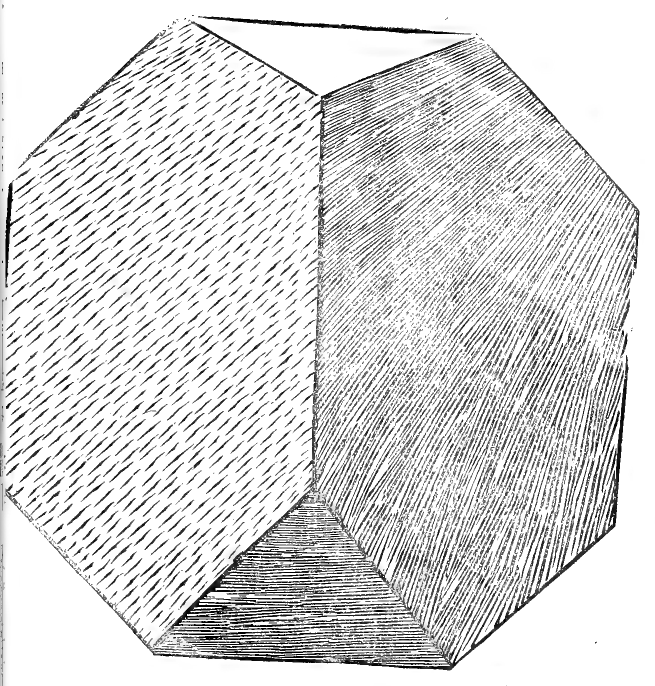

:layout: book
:canonical_id: Plate III
:folio: 0191

.. _plates-polyhedra-plate_03:
.. _plates-polyhedra-plate_03-en:

Plate III (Folio 0191) — Solid Truncated Tetrahedron
====================================================

.. rubric:: Perspective Woodcut by Leonardo da Vinci (1509)

.. folio:: 0191

   **Solid Truncated Tetrahedron** — :term:`*Tetrahedron Abscisum Solidum* <tetrahedron-abscisum>` (:term:`Τετράεδρον ἀποτετμημένον <tetrahedron-abscisum>` :term:`στερεόν <solidum>`)
