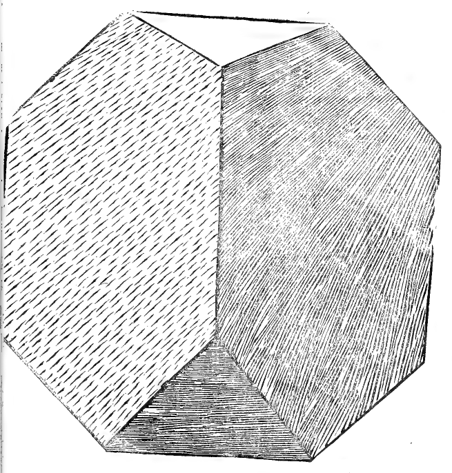

:layout: book
:canonical_id: Tabula III
:folio: 0191

.. _plates-polyhedra-plate_03-la:

Tabula III (Folio 0191) — Tetrahedron Abscisum Solidum
======================================================

.. rubric:: Figura Geometrica per Manum Leonardi Vincii (1509)

.. folio:: 0191

   :term:`*Tetrahedron Abscisum Solidum* <tetrahedron-abscisum>` (:term:`Τετράεδρον ἀποτετμημένον <tetrahedron-abscisum>` :term:`στερεόν <solidum>`)
