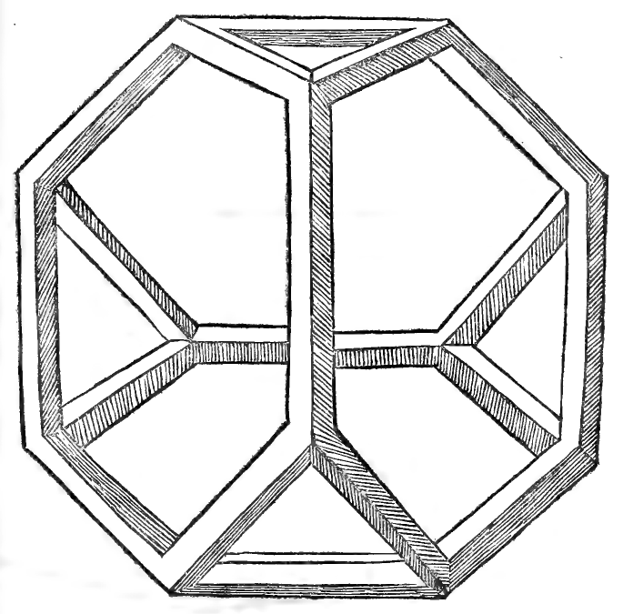

:layout: book
:canonical_id: Plate IIII
:folio: 0193

.. _plates-polyhedra-plate_04:
.. _plates-polyhedra-plate_04-en:

Plate IIII (Folio 0193) — Hollow Truncated Tetrahedron
======================================================

.. rubric:: Perspective Woodcut by Leonardo da Vinci (1509)

.. folio:: 0193

   **Hollow Truncated Tetrahedron** — :term:`*Tetrahedron Abscisum Vacuum* <tetrahedron-abscisum>` (:term:`Τετράεδρον ἀποτετμημένον <tetrahedron-abscisum>` :term:`κενόν <vacuum>`)
