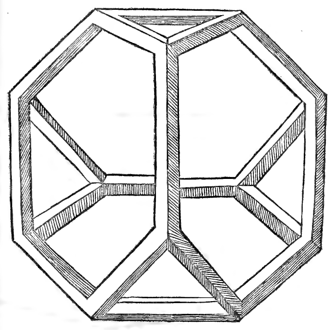

:layout: book
:canonical_id: Tabula IIII
:folio: 0193

.. _plates-polyhedra-plate_04-la:

Tabula IIII (Folio 0193) — Tetrahedron Abscisum Vacuum
======================================================

.. rubric:: Figura Geometrica per Manum Leonardi Vincii (1509)

.. folio:: 0193

   :term:`*Tetrahedron Abscisum Vacuum* <tetrahedron-abscisum>` (:term:`Τετράεδρον ἀποτετμημένον <tetrahedron-abscisum>` :term:`κενόν <vacuum>`)
