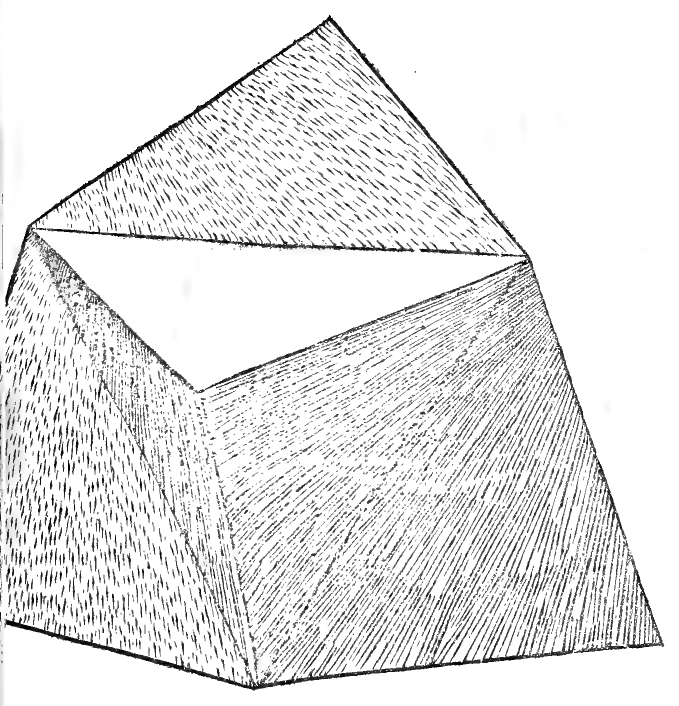

:layout: book
:canonical_id: Plate V
:folio: 0195

.. _plates-polyhedra-plate_05:
.. _plates-polyhedra-plate_05-en:

Plate V (Folio 0195) — Solid Stellated (Elevated) Tetrahedron
=============================================================

.. rubric:: Perspective Woodcut by Leonardo da Vinci (1509)

.. folio:: 0195

   **Solid Stellated (Elevated) Tetrahedron** — :term:`*Tetrahedron Elevatum Solidum* <tetrahedron-elevatum>` (:term:`Τετράεδρον ἐπηρμένον <tetrahedron-elevatum>` :term:`στερεόν <solidum>`)
