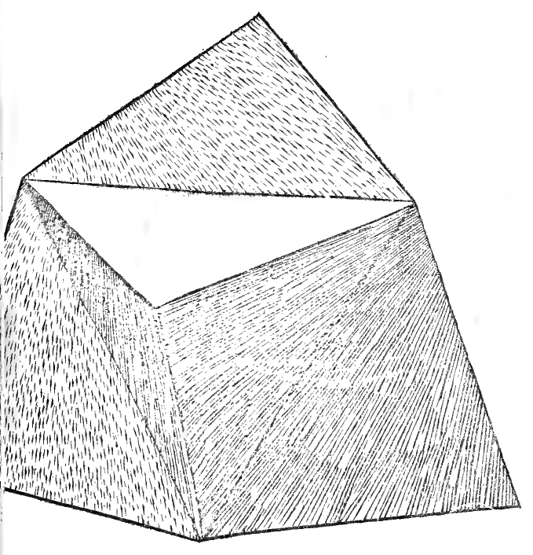

:layout: book
:canonical_id: Tabula V
:folio: 0195

.. _plates-polyhedra-plate_05-la:

Tabula V (Folio 0195) — Tetrahedron Elevatum Solidum
====================================================

.. rubric:: Figura Geometrica per Manum Leonardi Vincii (1509)

.. folio:: 0195

   :term:`*Tetrahedron Elevatum Solidum* <tetrahedron-elevatum>` (:term:`Τετράεδρον ἐπηρμένον <tetrahedron-elevatum>` :term:`στερεόν <solidum>`)
