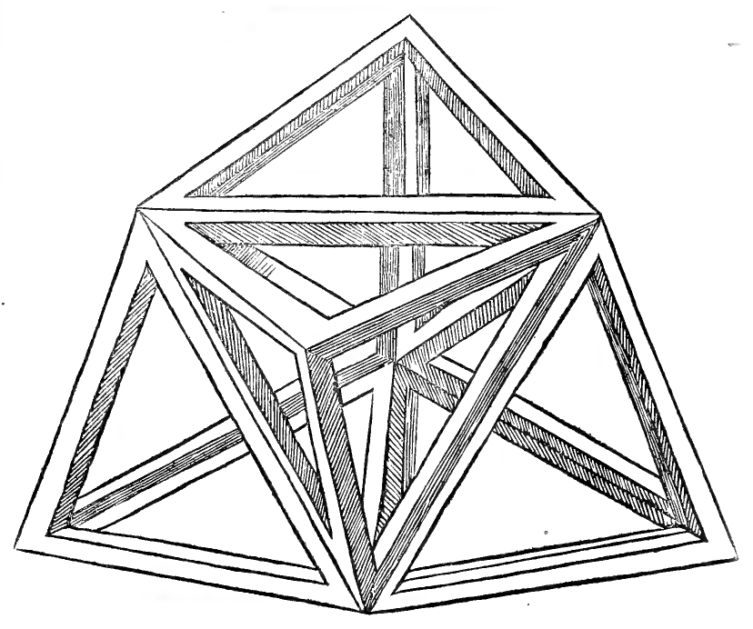

:layout: book
:canonical_id: Plate VI
:folio: 0197

.. _plates-polyhedra-plate_06:
.. _plates-polyhedra-plate_06-en:

Plate VI (Folio 0197) — Hollow Stellated (Elevated) Tetrahedron
===============================================================

.. rubric:: Perspective Woodcut by Leonardo da Vinci (1509)

.. folio:: 0197

   **Hollow Stellated (Elevated) Tetrahedron** — :term:`*Tetrahedron Elevatum Vacuum* <tetrahedron-elevatum>` (:term:`Τετράεδρον ἐπηρμένον <tetrahedron-elevatum>` :term:`κενόν <vacuum>`)
