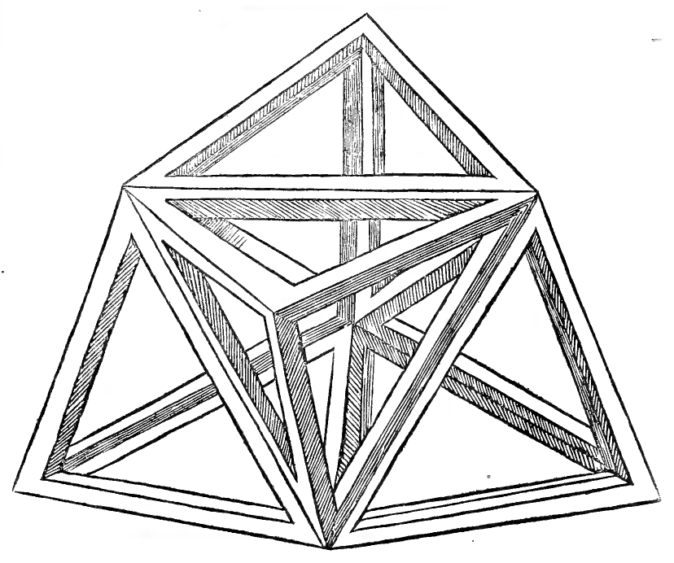

:layout: book
:canonical_id: Tabula VI
:folio: 0197

.. _plates-polyhedra-plate_06-la:

Tabula VI (Folio 0197) — Tetrahedron Elevatum Vacuum
====================================================

.. rubric:: Figura Geometrica per Manum Leonardi Vincii (1509)

.. folio:: 0197

   :term:`*Tetrahedron Elevatum Vacuum* <tetrahedron-elevatum>` (:term:`Τετράεδρον ἐπηρμένον <tetrahedron-elevatum>` :term:`κενόν <vacuum>`)
