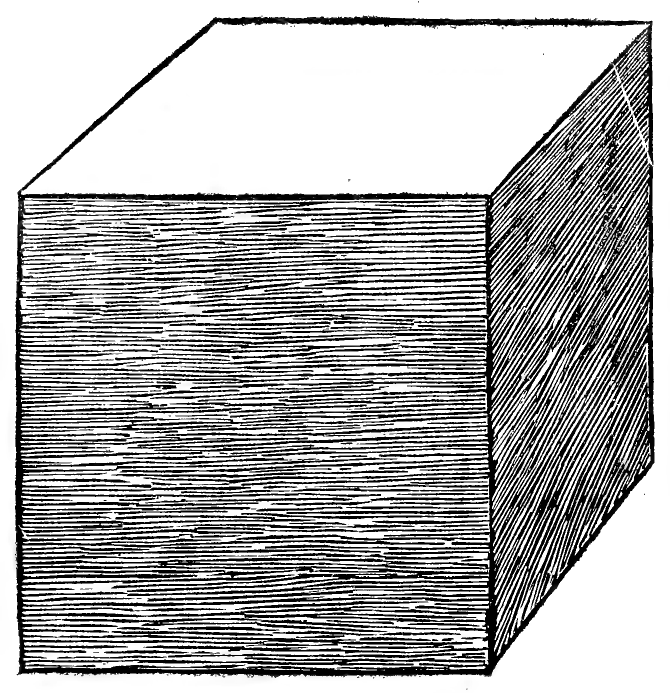

:layout: book
:canonical_id: Plate VII
:folio: 0199

.. _plates-polyhedra-plate_07:
.. _plates-polyhedra-plate_07-en:

Plate VII (Folio 0199) — Solid Regular Hexahedron (Cube)
========================================================

.. rubric:: Perspective Woodcut by Leonardo da Vinci (1509)

.. folio:: 0199

   **Solid Regular Hexahedron (Cube)** — :term:`*Exahedron sive Cubus Planum Solidum* <exahedron>` (:term:`Ἑξάεδρον <exahedron>` ἢ κύβος :term:`ἐπίπεδον <planum>` :term:`στερεόν <solidum>`)
