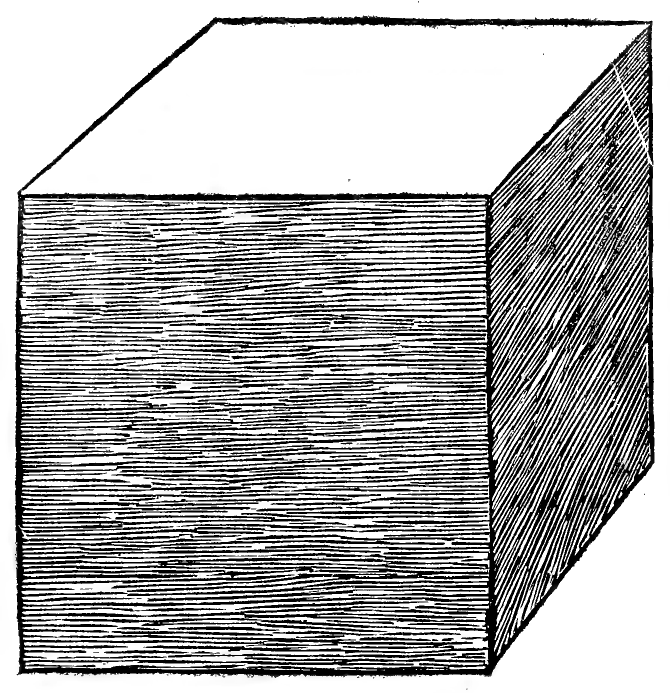

:layout: book
:canonical_id: Tabula VII
:folio: 0199

.. _plates-polyhedra-plate_07-la:

Tabula VII (Folio 0199) — Exahedron sive Cubus Planum Solidum
=============================================================

.. rubric:: Figura Geometrica per Manum Leonardi Vincii (1509)

.. folio:: 0199

   :term:`*Exahedron sive Cubus Planum Solidum* <exahedron>` (:term:`Ἑξάεδρον <exahedron>` ἢ κύβος :term:`ἐπίπεδον <planum>` :term:`στερεόν <solidum>`)
