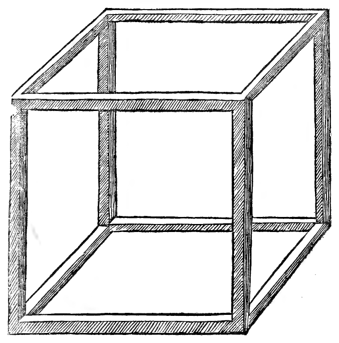

:layout: book
:canonical_id: Plate VIII
:folio: 0201

.. _plates-polyhedra-plate_08:
.. _plates-polyhedra-plate_08-en:

Plate VIII (Folio 0201) — Hollow Regular Hexahedron (Cube)
==========================================================

.. rubric:: Perspective Woodcut by Leonardo da Vinci (1509)

.. folio:: 0201

   **Hollow Regular Hexahedron (Cube)** — :term:`*Exahedron Planum Vacuum* <exahedron>` (:term:`Ἑξάεδρον <exahedron>` :term:`ἐπίπεδον <planum>` :term:`κενόν <vacuum>`)
