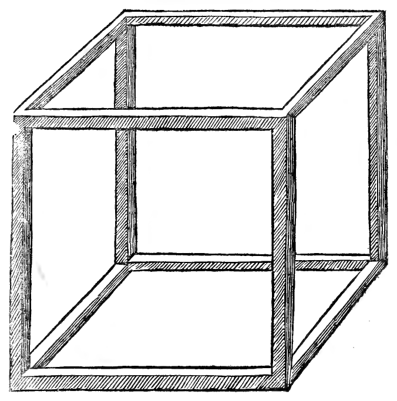

:layout: book
:canonical_id: Tabula VIII
:folio: 0201

.. _plates-polyhedra-plate_08-la:

Tabula VIII (Folio 0201) — Exahedron Planum Vacuum
==================================================

.. rubric:: Figura Geometrica per Manum Leonardi Vincii (1509)

.. folio:: 0201

   :term:`*Exahedron Planum Vacuum* <exahedron>` (:term:`Ἑξάεδρον <exahedron>` :term:`ἐπίπεδον <planum>` :term:`κενόν <vacuum>`)
