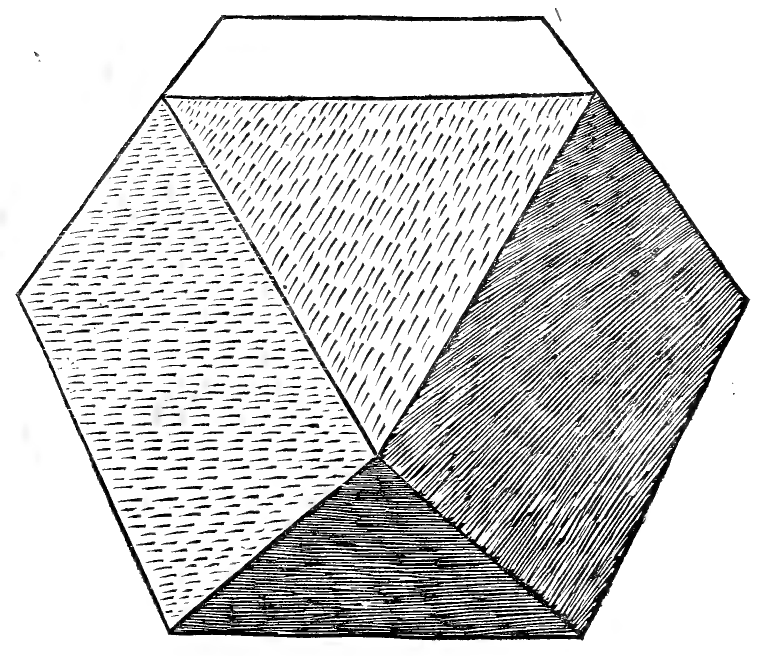

:layout: book
:canonical_id: Plate VIIII
:folio: 0203

.. _plates-polyhedra-plate_09:
.. _plates-polyhedra-plate_09-en:

Plate VIIII (Folio 0203) — Solid Truncated Hexahedron (Cuboctahedron)
=====================================================================

.. rubric:: Perspective Woodcut by Leonardo da Vinci (1509)

.. folio:: 0203

   **Solid Truncated Hexahedron (Cuboctahedron)** — :term:`*Exahedron Abscisum Solidum* <exahedron-abscisum>` (:term:`Ἑξάεδρον ἀποτετμημένον <exahedron-abscisum>` :term:`στερεόν <solidum>`)
