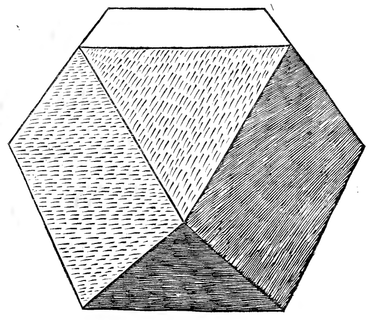

:layout: book
:canonical_id: Tabula VIIII
:folio: 0203

.. _plates-polyhedra-plate_09-la:

Tabula VIIII (Folio 0203) — Exahedron Abscisum Solidum
======================================================

.. rubric:: Figura Geometrica per Manum Leonardi Vincii (1509)

.. folio:: 0203

   :term:`*Exahedron Abscisum Solidum* <exahedron-abscisum>` (:term:`Ἑξάεδρον ἀποτετμημένον <exahedron-abscisum>` :term:`στερεόν <solidum>`)
