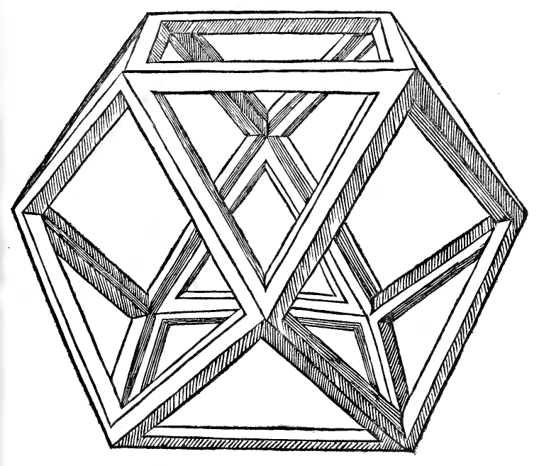

:layout: book
:canonical_id: Plate X
:folio: 0205

.. _plates-polyhedra-plate_10:
.. _plates-polyhedra-plate_10-en:

Plate X (Folio 0205) — Hollow Truncated Hexahedron (Cuboctahedron)
==================================================================

.. rubric:: Perspective Woodcut by Leonardo da Vinci (1509)

.. folio:: 0205

   **Hollow Truncated Hexahedron (Cuboctahedron)** — :term:`*Exahedron Abscisum Vacuum* <exahedron-abscisum>` (:term:`Ἑξάεδρον ἀποτετμημένον <exahedron-abscisum>` :term:`κενόν <vacuum>`)
