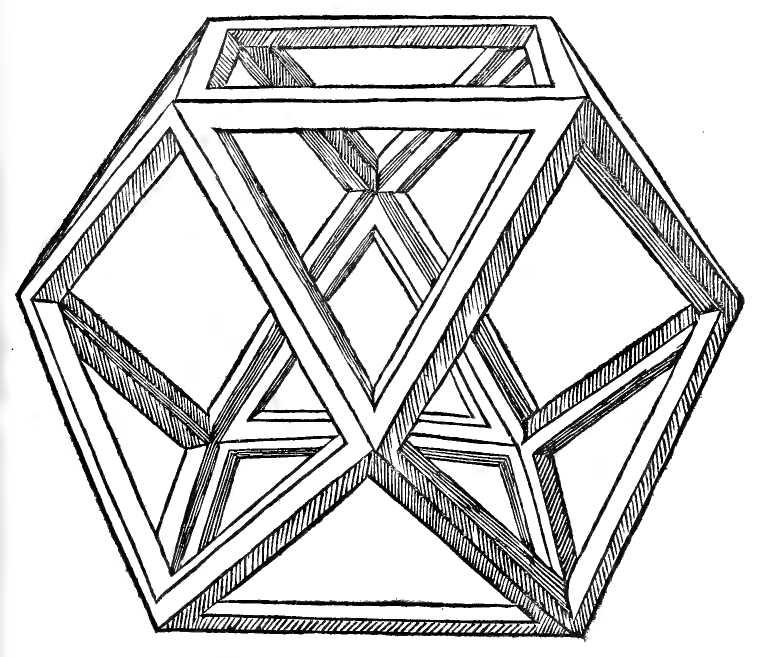

:layout: book
:canonical_id: Tabula X
:folio: 0205

.. _plates-polyhedra-plate_10-la:

Tabula X (Folio 0205) — Exahedron Abscisum Vacuum
=================================================

.. rubric:: Figura Geometrica per Manum Leonardi Vincii (1509)

.. folio:: 0205

   :term:`*Exahedron Abscisum Vacuum* <exahedron-abscisum>` (:term:`Ἑξάεδρον ἀποτετμημένον <exahedron-abscisum>` :term:`κενόν <vacuum>`)
