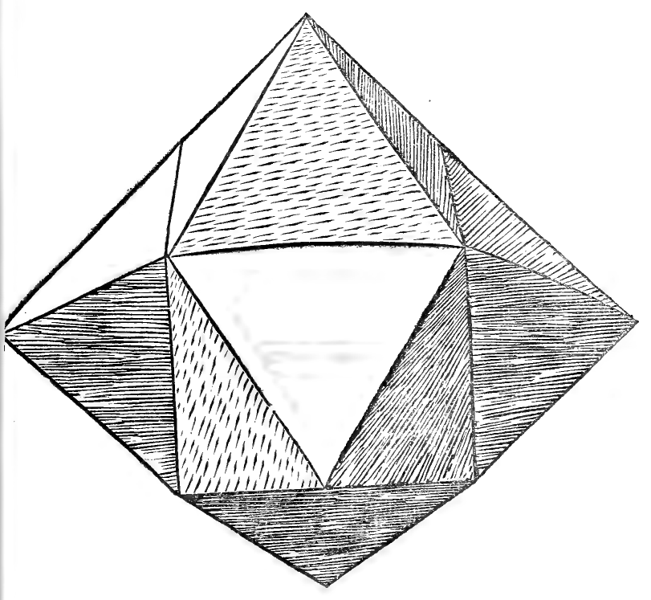

:layout: book
:canonical_id: Plate XI
:folio: 0207

.. _plates-polyhedra-plate_11:
.. _plates-polyhedra-plate_11-en:

Plate XI (Folio 0207) — Solid Elevated Hexahedron
=================================================

.. rubric:: Perspective Woodcut by Leonardo da Vinci (1509)

.. folio:: 0207

   **Solid Elevated Hexahedron** — :term:`*Exahedron Elevatum Solidum* <exahedron-elevatum>` (:term:`Ἑξάεδρον ἐπηρμένον <exahedron-elevatum>` :term:`στερεόν <solidum>`)
