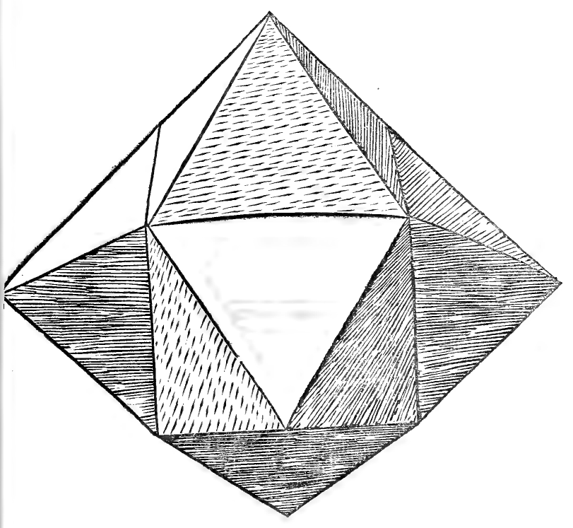

:layout: book
:canonical_id: Tabula XI
:folio: 0207

.. _plates-polyhedra-plate_11-la:

Tabula XI (Folio 0207) — Exahedron Elevatum Solidum
===================================================

.. rubric:: Figura Geometrica per Manum Leonardi Vincii (1509)

.. folio:: 0207

   :term:`*Exahedron Elevatum Solidum* <exahedron-elevatum>` (:term:`Ἑξάεδρον ἐπηρμένον <exahedron-elevatum>` :term:`στερεόν <solidum>`)
