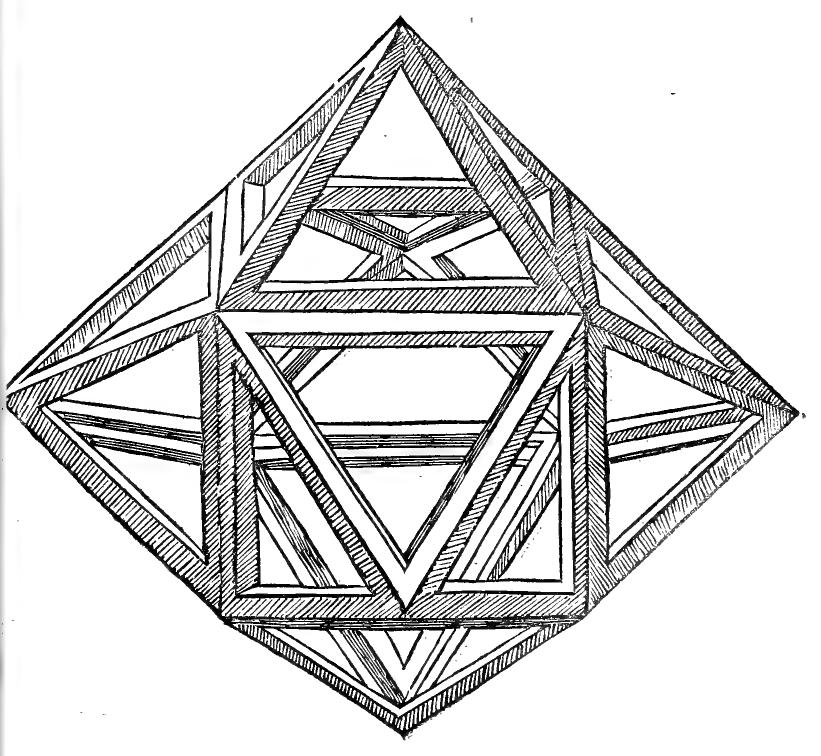

:layout: book
:canonical_id: Plate XII
:folio: 0209

.. _plates-polyhedra-plate_12:
.. _plates-polyhedra-plate_12-en:

Plate XII (Folio 0209) — Hollow Elevated Hexahedron
===================================================

.. rubric:: Perspective Woodcut by Leonardo da Vinci (1509)

.. folio:: 0209

   **Hollow Elevated Hexahedron** — :term:`*Exahedron Elevatum Vacuum* <exahedron-elevatum>` (:term:`Ἑξάεδρον ἐπηρμένον <exahedron-elevatum>` :term:`κενόν <vacuum>`)
