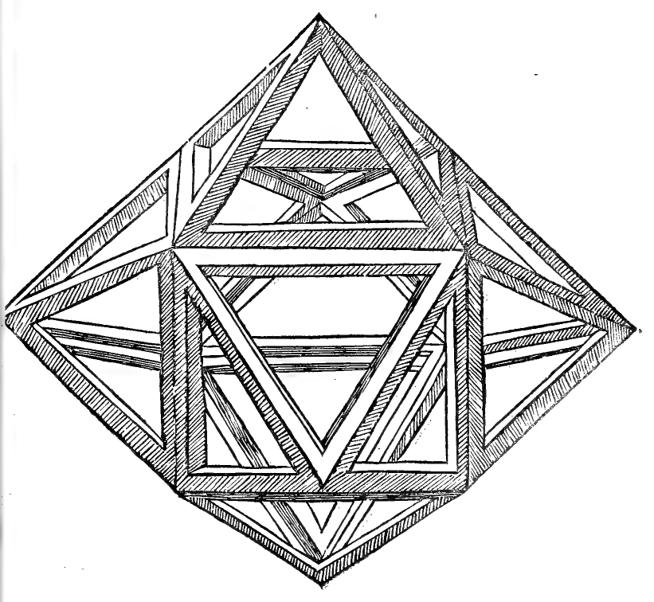

:layout: book
:canonical_id: Tabula XII
:folio: 0209

.. _plates-polyhedra-plate_12-la:

Tabula XII (Folio 0209) — Exahedron Elevatum Vacuum
===================================================

.. rubric:: Figura Geometrica per Manum Leonardi Vincii (1509)

.. folio:: 0209

   :term:`*Exahedron Elevatum Vacuum* <exahedron-elevatum>` (:term:`Ἑξάεδρον ἐπηρμένον <exahedron-elevatum>` :term:`κενόν <vacuum>`)
