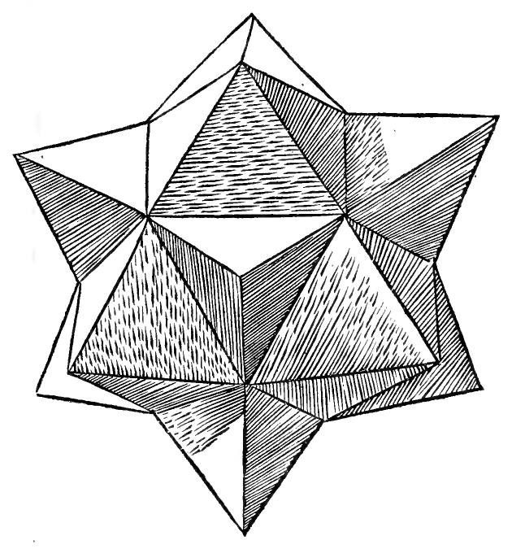

:layout: book
:canonical_id: Plate XIII
:folio: 0211

.. _plates-polyhedra-plate_13:
.. _plates-polyhedra-plate_13-en:

Plate XIII (Folio 0211) — Solid Elevated Truncated Hexahedron
=============================================================

.. rubric:: Perspective Woodcut by Leonardo da Vinci (1509)

.. folio:: 0211

   **Solid Elevated Truncated Hexahedron** — :term:`*Exahedron Abscisum Elevatum Solidum* <exahedron-abscisum-elevatum>` (:term:`Ἑξάεδρον ἀποτετμημένον ἐπηρμένον <exahedron-abscisum-elevatum>` :term:`στερεόν <solidum>`)
