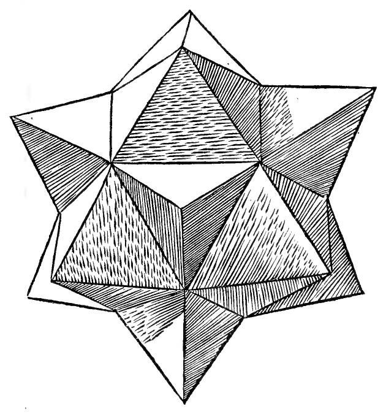

:layout: book
:canonical_id: Tabula XIII
:folio: 0211

.. _plates-polyhedra-plate_13-la:

Tabula XIII (Folio 0211) — Exahedron Abscisum Elevatum Solidum
==============================================================

.. rubric:: Figura Geometrica per Manum Leonardi Vincii (1509)

.. folio:: 0211

   :term:`*Exahedron Abscisum Elevatum Solidum* <exahedron-abscisum-elevatum>` (:term:`Ἑξάεδρον ἀποτετμημένον ἐπηρμένον <exahedron-abscisum-elevatum>` :term:`στερεόν <solidum>`)
