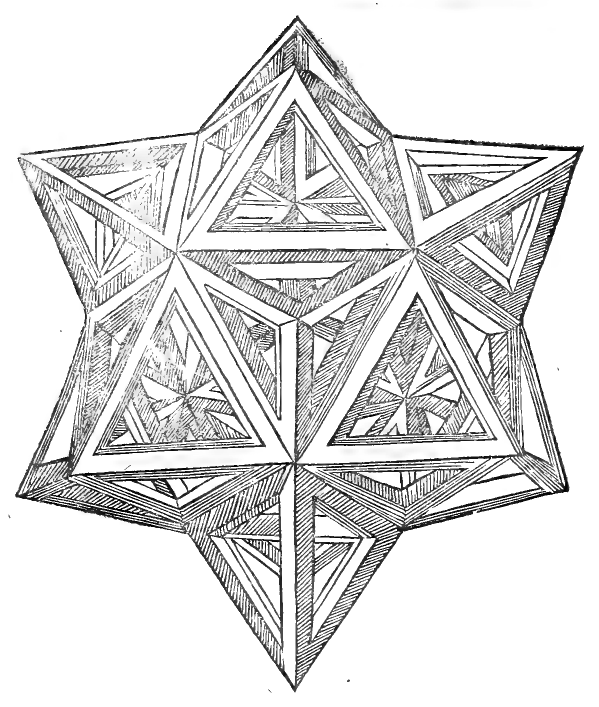

:layout: book
:canonical_id: Plate XIIII
:folio: 0217

.. _plates-polyhedra-plate_14:
.. _plates-polyhedra-plate_14-en:

Plate XIIII (Folio 0217) — Hollow Elevated Truncated Hexahedron
===============================================================

.. rubric:: Perspective Woodcut by Leonardo da Vinci (1509)

.. folio:: 0217

   **Hollow Elevated Truncated Hexahedron** — :term:`*Exahedron Abscisum Elevatum Vacuum* <exahedron-abscisum-elevatum>` (:term:`Ἑξάεδρον ἀποτετμημένον ἐπηρμένον <exahedron-abscisum-elevatum>` :term:`κενόν <vacuum>`)
