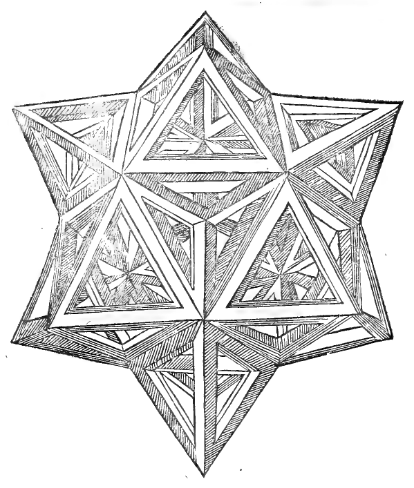

:layout: book
:canonical_id: Tabula XIIII
:folio: 0217

.. _plates-polyhedra-plate_14-la:

Tabula XIIII (Folio 0217) — Exahedron Abscisum Elevatum Vacuum
==============================================================

.. rubric:: Figura Geometrica per Manum Leonardi Vincii (1509)

.. folio:: 0217

   :term:`*Exahedron Abscisum Elevatum Vacuum* <exahedron-abscisum-elevatum>` (:term:`Ἑξάεδρον ἀποτετμημένον ἐπηρμένον <exahedron-abscisum-elevatum>` :term:`κενόν <vacuum>`)
