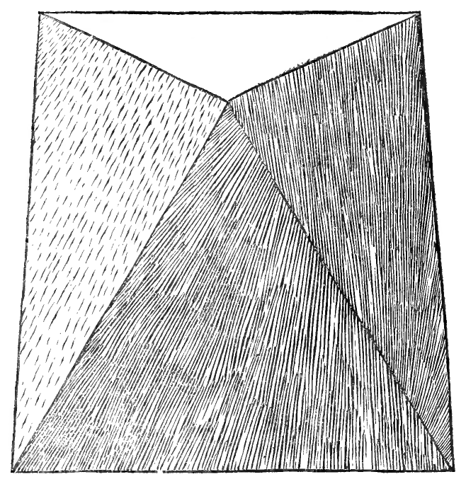

:layout: book
:canonical_id: Plate XV
:folio: 0219

.. _plates-polyhedra-plate_15:
.. _plates-polyhedra-plate_15-en:

Plate XV (Folio 0219) — Solid Regular Octahedron
================================================

.. rubric:: Perspective Woodcut by Leonardo da Vinci (1509)

.. folio:: 0219

   **Solid Regular Octahedron** — :term:`*Octahedron Planum Solidum* <octahedron>` (:term:`Ὀκτάεδρον <octahedron>` :term:`ἐπίπεδον <planum>` :term:`στερεόν <solidum>`)
